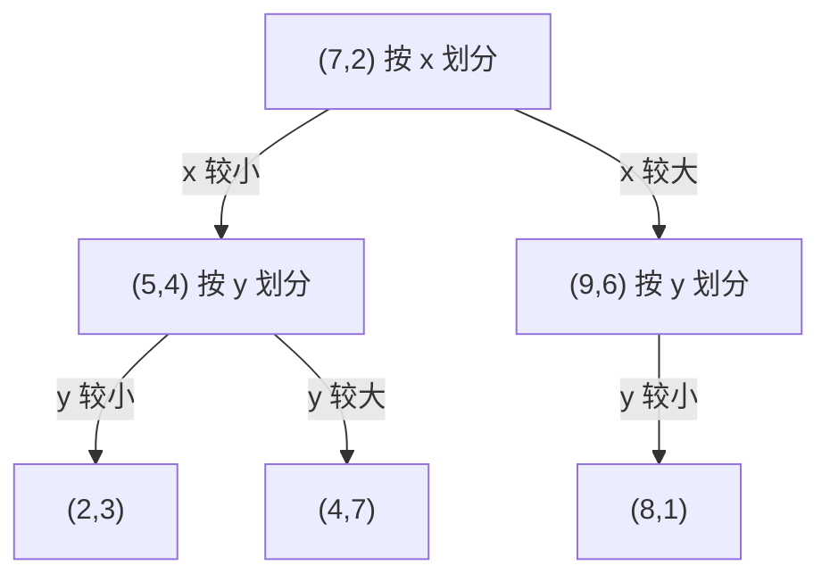

## 一、KNN 到底是什么？

### 1.1 从一个生活中的例子开始

假设你刚转学到一个新班级，想猜一位同学更喜欢打篮球还是踢足球。

你暂时不了解他，但注意到几位与他兴趣、性格和日常习惯比较相似的同学：

- 与他最相似的同学 A 喜欢篮球；
- 第二相似的同学 B 喜欢篮球；
- 第三相似的同学 C 喜欢足球。

如果让你根据这三位同学的情况作一个初步猜测，你大概率会猜“篮球”。理由是：三个相似的人中，有两个人喜欢篮球。

**KNN 的思想就这么朴素：一个新样本通常可以参考它附近、与它最相似的几个已有样本来判断。**

这有点像“物以类聚，人以群分”，但要注意，这只是帮助理解的直觉，并不保证所有问题中“离得近的样本”一定同类。KNN 的效果取决于数据是否适合用距离表示相似性。

### 1.2 KNN 名字中的 K、N、NN 是什么意思？

KNN 的英文名称是 **K-Nearest Neighbors**，中文叫 **K 近邻法**。

- **K**：选择多少个最近的邻居。例如 K=3，就参考最近的三个样本。
- **Nearest**：最近的。这里的“近”通常由特征之间的数学距离决定。
- **Neighbors**：邻居。指已有数据中，与待预测样本最接近的样本。

如果训练数据中一共有 N 个样本，那么 N 表示训练样本数；它不是算法名称中一个需要单独调节的参数。

例如，一共有 1000 条历史记录。我们预测一条新记录时，如果选择 K=5，便从这 1000 条历史记录里找出最接近它的 5 条，再根据这 5 条记录判断。

### 1.3 KNN 是一种监督学习算法

先区分两个词：

- **特征（feature）**：描述样本的属性，比如身高、体重、年龄、考试分数。
- **标签（label）**：我们希望预测的结果，比如“猫/狗”“是否合格”“喜欢篮球/足球”。

在监督学习中，训练数据同时包含特征和正确标签。例如：

| 样本 | 身高（cm） | 体重（kg） | 标签 |
| --- | ---: | ---: | --- |
| A | 170 | 60 | 篮球 |
| B | 175 | 65 | 篮球 |
| C | 160 | 55 | 足球 |
| D | 178 | 68 | 篮球 |

现在来了一个身高 173 cm、体重 63 kg 的新同学。我们知道他的两个特征，却不知道他的标签。KNN 就根据历史样本与他的距离，推测他更可能属于哪一类。

这里必须提醒一句：身高、体重未必真正决定运动偏好，这只是方便演示的例子。真实问题中的特征需要结合实际业务选择。

### 1.4 KNN 的完整预测流程

KNN 用于分类时，基本过程分为五步：

1. **准备训练数据**：保存已有样本的特征和标签。
2. **计算距离**：计算待预测样本与各个训练样本之间的距离。
3. **选出最近的 K 个**：按距离排序，挑出距离最小的 K 个训练样本。
4. **让邻居投票**：统计这 K 个样本分别属于哪些类别。
5. **输出预测类别**：通常选择票数最多的类别。

用一句话记忆：

**计算距离 → 找邻居 → 数票数 → 定类别。**

### 1.5 一个可以手算的分类例子

假设我们用两个数值特征描述一些动物。现在已有五个带标签的样本，要判断新样本 Q 属于“猫”还是“狗”。

新样本坐标为：

\[
Q=(3,3)
\]

已知训练数据如下：

| 训练样本 | 坐标 | 类别 | 到 Q 的欧氏距离 |
| --- | --- | --- | ---: |
| A | (1,1) | 猫 | \(\sqrt{8}\approx2.83\) |
| B | (2,2) | 猫 | \(\sqrt{2}\approx1.41\) |
| C | (4,3) | 狗 | \(1\) |
| D | (3,4) | 猫 | \(1\) |
| E | (5,5) | 狗 | \(\sqrt{8}\approx2.83\) |

假设 **K=3**，只需要看距离最近的三个样本：

- C：狗，距离 1；
- D：猫，距离 1；
- B：猫，距离约 1.41。

投票结果：猫 2 票，狗 1 票。

因此，KNN 把 Q 预测为 **猫**。

你可以看到，算法并没有事先推导出“猫的特征必须满足什么公式”。它只是直接参考训练集中与 Q 最接近的实例。

### 1.6 特殊情况：K=1

如果 K=1，那么只参考离新样本最近的**一个**训练样本。

例如上面的例子中，C 和 D 都距离 Q 为 1，出现最近邻并列；实际程序必须设定一个明确的并列处理规则。若最近的样本唯一，并且它是一只猫，那么新样本就会被预测为猫。

这种只参考一个最近邻居的方法，也叫 **最近邻算法（1-NN）**。

它非常直接，但也更容易被单个错误样本影响。关于这一点，我们在选择 K 值时再详细讨论。

## 二、距离度量：计算机怎样知道“谁更像谁”？

KNN 的第一件大事就是定义“近”。在现实生活中，我们通常说两个人“性格很像”“兴趣很像”，但计算机不能直接理解这些表达。

如果一个样本可以用一组数值表示，计算机便能够通过数学公式计算距离。**距离越小，通常代表样本越相似。**

### 2.1 将样本表示成坐标

例如：

- 学生 A：身高 170 cm，体重 60 kg；
- 学生 B：身高 175 cm，体重 65 kg。

可以写成：

\[
A=(170,60),\qquad B=(175,65)
\]

它们是二维向量。所谓“二维”，就是每个样本有两个数值特征。

如果加入年龄，样本就变成三维；如果有 100 个特征，就相当于处在一个 100 维的特征空间里。我们可能画不出 100 维空间，但依旧能用公式计算距离。

### 2.2 曼哈顿距离（Manhattan Distance，\(L_1\)）

想象你在一个道路横平竖直的城市中走路。你不能直接穿过建筑物，只能沿街道先横向走，再纵向走。

曼哈顿距离就是：**各个坐标相差多少，全部取绝对值后加起来。**

二维公式为：

\[
d_1(A,B)=|x_A-x_B|+|y_A-y_B|
\]

设：

\[
A=(1,2),\qquad B=(4,6)
\]

横向差 3，纵向差 4，所以：

\[
d_1(A,B)=|4-1|+|6-2|=3+4=\boxed{7}
\]

在更多维度的情况下，只要把每一维的差值绝对值加起来即可。

### 2.3 欧氏距离（Euclidean Distance，\(L_2\)）

欧氏距离就是我们最熟悉的**两点之间的直线距离**。

想象在操场上从 A 点直接走向 B 点，不必沿着横竖的街道绕路。它就是勾股定理的应用。

二维公式：

\[
d_2(A,B)=\sqrt{(x_A-x_B)^2+(y_A-y_B)^2}
\]

仍然取：

\[
A=(1,2),\qquad B=(4,6)
\]

那么：

\[
d_2(A,B)=\sqrt{(4-1)^2+(6-2)^2}
\]

\[
=\sqrt{3^2+4^2}=\sqrt{9+16}=\boxed{5}
\]

欧氏距离是 KNN 中非常常见的选择。不过“常见”不意味着对任何数据都最合适。

### 2.4 切比雪夫距离（Chebyshev Distance，\(L_\infty\)）

切比雪夫距离比较特别：它只关心**各个坐标差距中最大的那个**。

二维公式：

\[
d_\infty(A,B)=\max\{|x_A-x_B|,|y_A-y_B|\}
\]

仍然是上面的两个点：

- 横向相差 3；
- 纵向相差 4。

最大差距是 4，因此：

\[
d_\infty(A,B)=\max(3,4)=\boxed{4}
\]

你可以想象一个棋盘上的国王：如果一次能向任意相邻方向（包括斜向）走一步，从一个位置到另一个位置，最少需要的步数就与切比雪夫距离对应。

### 2.5 三种距离的对比

对于同样的点 \(A=(1,2)\)、\(B=(4,6)\)：

| 距离 | 通俗理解 | 计算方式 | 结果 |
| --- | --- | --- | ---: |
| 曼哈顿距离 \(L_1\) | 沿横竖街道走 | 各维绝对差值之和 | 7 |
| 欧氏距离 \(L_2\) | 两点直线距离 | 各维差值平方和开方 | 5 |
| 切比雪夫距离 \(L_\infty\) | 只看最大坐标差 | 各维绝对差值的最大值 | 4 |

这三种结果不同，并不是谁算错了，而是因为“距离”有不同的定义。

### 2.6 同一组数据，换一种距离，最近邻可能会改变

看下面这个例子。已有三个点：

\[
x_1=(1,1),\quad x_2=(5,1),\quad x_3=(4,4)
\]

我们站在 \(x_1\)，想比较 \(x_2\) 与 \(x_3\) 哪一个更近。

**先算曼哈顿距离：**

\[
d_1(x_1,x_2)=|5-1|+|1-1|=4
\]

\[
d_1(x_1,x_3)=|4-1|+|4-1|=6
\]

所以在曼哈顿距离下，\(x_2\) 更近。

**再算欧氏距离：**

\[
d_2(x_1,x_2)=\sqrt{4^2+0^2}=4
\]

\[
d_2(x_1,x_3)=\sqrt{3^2+3^2}=\sqrt{18}\approx4.24
\]

欧氏距离下，仍然是 \(x_2\) 更近。

**最后算切比雪夫距离：**

\[
d_\infty(x_1,x_2)=\max(4,0)=4
\]

\[
d_\infty(x_1,x_3)=\max(3,3)=3
\]

这次变成了 \(x_3\) 更近。

汇总如下：

| 距离类型 | \(x_1\) 到 \(x_2\) | \(x_1\) 到 \(x_3\) | 最近邻 |
| --- | ---: | ---: | --- |
| 曼哈顿 | 4 | 6 | \(x_2\) |
| 欧氏 | 4 | \(\sqrt{18}\approx4.24\) | \(x_2\) |
| 切比雪夫 | 4 | 3 | \(x_3\) |

**重要结论：距离度量的选择会改变邻居的排列顺序，因而可能改变最终分类结果。**

### 2.7 把三种距离统一起来：闵可夫斯基距离

它们其实可以用一个更一般的公式表示：

\[
d_p(x,y)=\left(\sum_{j=1}^{m}|x_j-y_j|^p\right)^{1/p},\qquad p\ge1
\]

其中 \(m\) 是特征维数：

- \(p=1\) 时，得到曼哈顿距离；
- \(p=2\) 时，得到欧氏距离；
- 当 \(p\) 越来越大并趋向无穷时，得到切比雪夫距离。

这个家族叫**闵可夫斯基距离（Minkowski Distance）**。

入门阶段不用刻意背复杂的推导，记住：**曼哈顿是求和，欧氏是平方和开方，切比雪夫是取最大值。**

## 三、使用距离之前，为什么必须处理特征？

现在出现一个实际问题：并不是所有数值都适合直接拿来计算距离。

假设用两个特征衡量学生：

- 身高：单位是厘米，数值大约 150～190；
- 月零花钱：单位是元，数值可能从几十到几千。

如果我们直接使用欧氏距离，零花钱的差异可能远远盖过身高的差异。即便我们原本认为两个特征同样重要，实际计算却让数值范围大的那一项拥有了更大影响力。

### 3.1 数值尺度问题

考虑两个数据记录：

\[
x=(\text{true},0.2,254)
\]

\[
y=(\text{false},0.1,194)
\]

它们分别包含一个布尔属性、一个小数属性和一个较大数值的属性。

如果把布尔值简单编码成 true=1、false=0，那么三项差距分别是：

- 第一项：1；
- 第二项：0.1；
- 第三项：60。

直接算欧氏距离，第三项的平方是 \(60^2=3600\)，而第二项的平方只有 \(0.1^2=0.01\)。第三项几乎控制了整个距离。

这不一定合理。数值大只说明量纲或取值范围大，不等于这个特征对分类一定更重要。

### 3.2 归一化：把不同特征放在相近范围

一个常见方法是**最小—最大归一化**：

\[
x'=\frac{x-x_{\min}}{x_{\max}-x_{\min}}
\]

如果一项特征在训练数据中的最小值是 100，最大值是 200，那么原来的 150 就变成：

\[
x'=\frac{150-100}{200-100}=0.5
\]

这样通常可以把训练数据中该特征的数值映射到 0～1 的范围。

但注意：如果后续出现超过原训练范围的新值，归一化结果也可能小于 0 或大于 1；这不代表计算错误。

### 3.3 标准化：以均值为中心调整尺度

另一种常见方法是 **Z-score 标准化**：

\[
z=\frac{x-\mu}{\sigma}
\]

其中：

- \(\mu\) 是该特征在训练数据中的均值；
- \(\sigma\) 是标准差。

标准化后的特征通常具有“均值接近 0、标准差接近 1”的性质，能够降低不同特征量纲带来的不合理影响。

归一化与标准化没有绝对的优劣，需要结合数据分布和验证结果选择。对于严重偏斜或异常值很多的特征，有时还需要其他处理方法。

**很重要的实操原则：只能用训练集计算归一化或标准化所需的统计量，再把同一套变换应用到验证集、测试集和未来的新数据。** 如果提前查看了测试集的统计信息，就可能造成“数据泄漏”，让测试结果看起来比实际效果更好。

### 3.4 不是数值的特征该怎么办？

有些特征是：

- 是否有某种属性：是/否；
- 喜欢的颜色：红、蓝、绿；
- 季节：春、夏、秋、冬。

这些数据不能想当然地当成普通连续数值。例如把颜色编码为红=1、蓝=2、绿=3，会让“红与绿的数值距离”为 2，但这种大小关系通常并没有实际意义。

常见的办法包括：

- 对真正只有两种状态的特征使用 0/1 编码；
- 对无大小顺序的类别使用独热编码（one-hot encoding）；
- 对混合类型的数据设计合适的距离函数。

实际使用时，也需要处理缺失值，因为普通的距离公式不能直接处理“某个坐标没有数值”的情况。

### 3.5 不相关的特征会误导 KNN

假设我们想根据健康数据判断某个样本的风险类别，记录了：

- 体温；
- 血压；
- 心率；
- 鞋码。

前三项可能与目标有比较直接的关系，鞋码却可能几乎没有帮助。

如果把所有特征一股脑地放进距离公式，鞋码仍会影响“谁离谁最近”。加入大量无关特征后，本来很相似的样本反而可能被距离计算分开。

因此，**特征越多不一定越好；与任务有关、能够代表真实相似性的特征更重要。**

## 四、K 值怎么选？小 K 和大 K 为什么都可能出问题？

理解了距离，接下来就需要决定：到底找几个邻居？

这个数量就是 **K**，也是 KNN 最重要的超参数之一。

“超参数”可以理解成：算法运行前需要人为设定或通过验证方法选择的配置，而不是模型从数据中自动学出的普通系数。

### 4.1 K 太小：容易被个别样本带偏

假设某个区域里实际上有 9 只猫、1 只狗，而那只狗刚好位于待预测样本的最近位置。

如果 K=1，算法只看这一只狗，就会把新样本判为狗。

但如果最近的 5 个邻居中有 4 只猫、1 只狗，K=5 就会预测猫。

这说明：**K 过小时，算法非常在意个别点，对噪声、误标数据和异常值比较敏感。**

比如一只猫被错误标记为狗，如果新样本恰好靠近这个错误标签，1-NN 就可能立刻受到影响。

在机器学习中，这种对训练数据的局部细节和偶然波动过分敏感的现象，通常与**过拟合（overfitting）**相关。

通俗地说：就像复习考试时，只背几道碰巧遇到的题，结果换一道题便不会了。

### 4.2 K 太大：容易忽略局部差别

再想象另一种情况：K=100。

这意味着不管新样本处于什么位置，都要参考最近的 100 个训练样本。它们中可能已经有很多离新样本很远、并不真正相似。

极端情况下，如果 **K 等于整个训练集的样本数 N**，那么每次预测都会参考全部训练数据。使用普通多数投票时，只要全局类别分布不变，模型通常会对所有新样本预测训练集中数量最多的那个类别。

这样就很难根据局部位置做出精细判断了。

这与机器学习中的**欠拟合（underfitting）**有关：模型太粗糙，没能抓住真正存在的类别结构。

通俗地说：只记住“大家一般是什么情况”，却忽略每个人的具体差异。

### 4.3 小 K 与大 K 的对比

| 对比角度 | K 较小 | K 较大 |
| --- | --- | --- |
| 参考范围 | 非常局部 | 更宽的邻域 |
| 对细节的反应 | 很敏感 | 相对平缓 |
| 对噪声的反应 | 通常更敏感 | 通常更稳定 |
| 可能的问题 | 过拟合 | 欠拟合 |
| 分类边界 | 更曲折、复杂 | 往往更平滑 |

从“偏差—方差”的角度，也可以把它理解成：小 K 往往方差较高，大 K 往往偏差较高。这是一种常见趋势，而不是对每个数据集都绝对成立的定律。

### 4.4 K 取奇数就一定不会平票吗？

一个常见建议是：做**二分类**时可以尝试奇数 K，例如 3、5、7，这能避免在普通多数投票中出现两类票数完全相同的情况。

但要注意两个限制：

1. 这只对二分类的普通投票有这个效果；如果有三种或更多类别，K 是奇数也可能平票。
2. 即使没有投票平局，也可能出现多个训练样本到新样本的距离相同，需要定义邻居选取的并列处理规则。

因此，**奇数 K 是实用的小技巧，并不是普遍的数学保证。**

### 4.5 怎样选一个比较合适的 K？

最可靠的思路之一是：**在训练数据上进行交叉验证**。

例如你可以尝试：

\[
K\in\{1,3,5,7,9,11\}
\]

然后比较它们在未参与对应训练的验证数据上的表现，选择效果较好的 K。

把这个过程比作考试：

- 训练集相当于平时学习使用的教材和练习；
- 验证集相当于模拟考试，用来挑选学习方法；
- 测试集相当于最终考试，用来评估最终方案。

只看训练集准确率是不够的。K=1 在训练样本上通常表现得非常好，但不代表面对新样本时也会最好。

### 4.6 什么是 K 折交叉验证？

假设有 100 条可用于训练和调参的数据，我们决定做 5 折交叉验证。

简单理解为：

1. 把数据分成大致等量的 5 份；
2. 第 1 轮，用其中 4 份作为训练数据，剩下 1 份用于验证；
3. 第 2 轮，换另一份做验证；
4. 一共做 5 轮，让每份数据都轮流承担一次验证任务；
5. 计算每个候选 K 在这 5 轮中的平均表现。

例如得到如下**假设结果**：

| K 值 | 五折平均验证准确率（示例） |
| ---: | ---: |
| 1 | 84% |
| 3 | 89% |
| 5 | 92% |
| 7 | 90% |
| 9 | 87% |

在这组示例结果中，我们倾向于先选择 **K=5**，再使用独立测试集进行最终评价。

如果类别比例不平衡，通常还要考虑分层抽样，让各折中的类别比例尽量合理；评价指标也不能只看准确率。

### 4.7 选择 K 时需要同时考虑哪些因素？

K 并不是孤立存在的。

- 如果距离度量改变了，合适的 K 可能改变。
- 如果做了标准化，邻居排列可能改变，合适的 K 也可能改变。
- 如果样本很多，K 可尝试的范围通常与小数据集不同。
- 如果任务更在意少数类的识别能力，最优 K 未必是“准确率最高的 K”。

因此，一个可靠的实践方式是**把预处理、距离度量和 K 值当作一套完整方案共同验证**。

## 五、分类决策规则：找到邻居之后，怎样做决定？

找到了最近的 K 个邻居，下一步就是把邻居的标签转化为预测结果。

最常见的是多数表决，也可以使用距离加权投票。

### 5.1 多数表决：谁票数最多，就选谁

假设 K=7，最近的 7 个邻居分别属于：

- 猫：4 个；
- 狗：2 个；
- 兔子：1 个。

投票结果是猫 4 票、狗 2 票、兔子 1 票，所以预测类别为**猫**。

对于普通分类 KNN，可以写成：

\[
\hat y(x)=\arg\max_c\sum_{i\in N_K(x)}\mathbf1(y_i=c)
\]

这里：

- \(x\) 是待预测的新样本；
- \(N_K(x)\) 是距离它最近的 K 个训练样本的索引集合；
- \(y_i\) 是第 \(i\) 个邻居的已知类别；
- \(\mathbf1(y_i=c)\) 表示“如果第 \(i\) 个邻居属于类别 c，就记 1 票，否则记 0 票”；
- \(\arg\max\) 表示找出票数最多的类别。

不用害怕公式：它只是把“数一数哪个类别出现最多”写成了数学语言。

### 5.2 多数表决为什么与“经验风险最小化”有关？

这个词听起来很抽象，可以把它拆开：

- **经验**：我们手头已经看到的样本；
- **风险**：预测错的代价；
- **最小化**：选一个让错误代价尽量小的结果。

假设最近的 7 个邻居中有 4 只猫、2 只狗、1 只兔子。

如果我们把新样本判断成：

- 猫，那么邻居中有 3 个标签不一致；
- 狗，那么邻居中有 5 个标签不一致；
- 兔子，那么邻居中有 6 个标签不一致。

显然，选择“猫”能让这个局部邻域中**标签不一致的数量最少**。

如果用最简单的 **0-1 损失**衡量错误：预测正确损失为 0，预测错误损失为 1，那么预测类别 c 的局部平均损失为：

\[
R(c\mid x)=\frac1K\sum_{i\in N_K(x)}\mathbf1(y_i\ne c)
\]

选择让这个值最小的类别，恰好等价于普通多数表决。

**所以，多数表决可以理解为：在最近的 K 个邻居中，让 0-1 分类错误尽可能少。**

请注意，这里指的是“局部邻域内”的经验风险，不等于它能保证在未来所有新数据上的错误率都最低。

### 5.3 平票了怎么办？

例如 K=4：

- 猫 2 票；
- 狗 2 票。

这时普通多数表决无法唯一确定类别。常用的处理办法包括：

1. 采用固定的类别优先级或稳定的实现规则；
2. 参考这些邻居的距离，让更近的样本拥有更高权重；
3. 重新考虑 K 的设置。

真实程序一定要有明确的平票处理逻辑，这样同样的数据才能得到可复现的结果。

### 5.4 距离加权投票：更近的邻居说话更有分量

普通投票默认每个邻居都是 1 票。可是如果最近的邻居只有 0.01 的距离，最远的第 K 个邻居有 100 的距离，让它们投同样重的一票是否合理？

一种改进办法是让距离越近的邻居权重越大。例如可以设：

\[
w_i=\frac{1}{d(x,x_i)+\varepsilon}
\]

其中 \(\varepsilon>0\) 是一个很小的数，用来避免距离为 0 时出现除以 0 的问题。

然后把每一类得到的权重相加，选择总权重最大的类别。

举个例子，K=3：

| 邻居 | 类别 | 距离 | 示例权重（约） |
| --- | --- | ---: | ---: |
| A | 猫 | 0.2 | 5.0 |
| B | 狗 | 1.0 | 1.0 |
| C | 狗 | 1.2 | 0.83 |

普通投票：狗 2 票、猫 1 票，预测狗。

距离加权投票：猫约 5.0 分、狗约 1.83 分，预测猫。

这说明：**加权投票可能改变分类结果。**

但距离加权不一定总比普通投票好。特别是最近邻本身存在噪声或错误标签时，给它太大的权重也可能放大问题。最好仍然通过验证决定是否使用。

## 六、KNN 的分类边界和“懒惰学习”

### 6.1 分类边界是什么？

想象平面上有许多红点和蓝点。我们在平面上随便找一个新位置，KNN 都会根据邻近的红、蓝样本给它一个类别。

当我们把所有预测为红色的区域涂红，把所有预测为蓝色的区域涂蓝，两种颜色交界的线就是**分类决策边界**。

K 小的时候，预测容易随着单个邻居的变化而变化，因此边界可能非常曲折。

K 大的时候，需要多个邻居共同改变投票结果，边界通常更加平滑。

这是理解“过拟合与欠拟合”的另一种方式：

- 边界过于曲折，可能把训练数据中的噪声当成真实规律；
- 边界过于平滑，可能漏掉真实存在的复杂类别结构。

### 6.2 为什么 KNN 被称为“懒惰学习”？

许多机器学习方法会在训练阶段学习出参数，例如一条分类直线的系数。

KNN 通常不需要先学习这样的一组全局分类系数。它主要把训练样本保存起来，等新样本到来时，再计算距离、寻找邻居、作出预测。

所以它被称为**懒惰学习（lazy learning）**。

这个名字并不是说算法不好，而是说它把大量工作放在了预测阶段。

因此，KNN 有一个很鲜明的特点：

**训练过程相对简单，但预测可能比较费时间。**

当然，如果事先建立了 kd 树等索引结构，那么准备阶段依然需要一定工作量。

## 七、KNN 为什么会慢？怎样引出 kd 树？

假设你保存了 100 万个训练样本，现在要预测一个新样本的类别。

最直接的方法是：

1. 计算新样本到 100 万个训练样本的距离；
2. 找出最近的 K 个；
3. 进行投票。

如果新样本只有一条，或许还能接受。但如果每天要预测几十万条新数据，重复做距离计算可能造成很大的时间开销。

这时我们自然会想：

> 能不能提前把训练样本整理得更有条理，让寻找邻居时不必每次都检查全部样本？

**kd 树就是用来组织空间中的点，并加速邻居搜索的一种数据结构。**

### 7.1 用“找便利店”理解 kd 树

假设你在一座大城市里寻找离自己最近的便利店。

办法一：查看全市每家便利店，分别算距离，再比较。

办法二：先把城市分成东区和西区，然后把每个区域继续划成南区和北区，再划成更小的区域。查找时优先搜索自己所在区域附近的便利店，并在必要时检查邻近区域。

第二种办法与 kd 树的思想很像：**不断划分空间，并利用划分信息排除不可能包含更近邻居的区域。**

### 7.2 注意区分 KNN 的 K 和 kd 树的 k

这两个字母很容易混淆：

- **KNN 的 K**：参考多少个邻居；
- **kd 树的 k**：数据所在空间的特征维数。比如二维点构成的是 2d 树的典型应用场景。

它们表示完全不同的概念。一个有 100 个特征的数据集可以使用 kd 树组织点，同时预测时仍然选择 K=5 个最近邻。

## 八、kd 树怎样构造？一步一步手工建树

下面用六个二维点构造一棵 kd 树：

\[
(2,3),\ (5,4),\ (9,6),\ (4,7),\ (8,1),\ (7,2)
\]

为了便于理解，我们采用一个常见的建树规则：

1. 这一层选一个坐标轴；
2. 按该坐标轴的数值排序，选择中位数附近的一个样本作为当前结点；
3. 比它小的点放到一边，大的点放到另一边；
4. 下一层切换坐标轴，递归处理左右两边。

由于偶数个点时存在两种中位数候选，而且相等坐标的处理方式可以不同，**同一组点不一定只有一种合法 kd 树**。我们只需要明确规则、前后一致即可。

### 8.1 第一步：按照 x 坐标进行划分

先按 x 值排序：

| 顺序 | 点 | x 坐标 |
| ---: | --- | ---: |
| 1 | (2,3) | 2 |
| 2 | (4,7) | 4 |
| 3 | (5,4) | 5 |
| 4 | (7,2) | 7 |
| 5 | (8,1) | 8 |
| 6 | (9,6) | 9 |

选取靠近中位数的 \((7,2)\) 作为根结点。

它相当于画了一条竖直分割线：

\[
x=7
\]

于是：

- 左侧点：\((2,3),(4,7),(5,4)\)；
- 右侧点：\((8,1),(9,6)\)。

根结点本身保存样本 \((7,2)\)。

### 8.2 第二步：切换到 y 坐标

在左侧区域，点的 y 坐标分别为：

\[
3,\ 7,\ 4
\]

排序得到：

\[
3,\ 4,\ 7
\]

选中位点 \((5,4)\) 作为左子树的根。它用水平线 \(y=4\) 把左区域继续分成上下两部分：

- 较小的 y 一侧：\((2,3)\)；
- 较大的 y 一侧：\((4,7)\)。

在根结点右侧区域，两个点是 \((8,1)\) 和 \((9,6)\)。这一层同样按 y 坐标划分。这里选择 \((9,6)\) 作为右子树的根，\((8,1)\) 进入它的一侧子树。

### 8.3 第三步：继续划分，直到安排完所有点

最后形成一棵可能的 kd 树：



注意，它是一棵**空间划分树**，不是按照类别标签建立的分类决策树。

kd 树结点通常保存样本点，并记录该层使用的划分维度。KNN 可以利用它更快地寻找最近邻，但分类标签最终仍然由邻居投票决定。

### 8.4 kd 树为什么要交替选择坐标轴？

如果在二维空间里永远只按 x 划分，空间就会不断被竖线切开，可能无法有效利用 y 方向的信息。

所以常见做法是按维度循环：

\[
x\rightarrow y\rightarrow x\rightarrow y\rightarrow\cdots
\]

如果是三维空间，则可以轮流使用：

\[
x\rightarrow y\rightarrow z\rightarrow x\rightarrow\cdots
\]

也有其他建树策略，比如根据当前数据分布选择变化较大的维度。无论哪一种，目的都是让空间划分便于后续搜索。

## 九、kd 树怎样搜索最近邻？为什么不能只向下走？

建树只是第一步。真正难理解的是：给定一个新点，如何用树找到它的最近邻？

先记住两个动作：

**向下查找，向上回溯。**

### 9.1 第一阶段：从根结点向下查找

假设要查询的点是：

\[
Q=(5,3)
\]

我们使用上一节建好的树。

从根结点 \((7,2)\) 出发：

1. 根结点按 x 划分。因为 \(Q\) 的 x=5 小于 7，所以先走左子树。
2. 到达 \((5,4)\)，这一层按 y 划分。因为 \(Q\) 的 y=3 小于 4，所以继续走它的较小 y 一侧。
3. 到达叶结点 \((2,3)\)。

这一步的目的，是按照空间划分迅速找到一个与 Q 可能接近的区域。

### 9.2 第二阶段：记录当前最近点

先算 Q 到叶结点 \((2,3)\) 的欧氏距离：

\[
d(Q,(2,3))=\sqrt{(5-2)^2+(3-3)^2}=3
\]

于是暂时记录：

- 当前候选最近邻：\((2,3)\)；
- 当前最短距离：3。

但它只是**暂时**的答案。

### 9.3 第三阶段：向上回溯，检查父结点

沿原路径返回到父结点 \((5,4)\)，计算：

\[
d(Q,(5,4))=\sqrt{(5-5)^2+(3-4)^2}=1
\]

距离 1 明显小于之前的距离 3，所以更新：

- 当前候选最近邻：\((5,4)\)；
- 当前最短距离：1。

**这里已经能看出：第一次向下走到的叶结点，不一定是真正最近的点。** 如果只走到叶子就停止，会得出错误结果。

### 9.4 为什么还要考虑另一侧子树？

返回父结点时，除了比较父结点本身，还要思考：**被我们暂时没走的另一侧区域，会不会藏着更近的点？**

例如某条分割线是 \(y=4\)，而查询点的 y=3。查询点到这条分割线的最短距离是：

\[
|3-4|=1
\]

如果目前找到的最近邻距离也是 1，那么另一侧空间在几何上仍有可能出现距离不大于 1 的点，是否需要访问取决于实现的并列规则与搜索目标。

更加一般地说，采用欧氏距离时：

- 如果**查询点到分割线的距离大于当前最短距离**，另一侧不可能存在更近的点，可以剪枝跳过；
- 如果**查询点到分割线的距离小于当前最短距离**，另一侧有可能存在更近的点，需要继续搜索；
- 如果刚好相等，通常需要按照是否保留等距离候选的要求谨慎处理。

这里所谓**剪枝**，就是“通过数学判断，提前排除不值得搜索的一整块区域”。

### 9.5 用“圆是否碰到分割线”理解回溯

想象我们以查询点 Q 为圆心，以当前最短距离 r 为半径画一个圆。

- 圆完全没有碰到某个被跳过的区域，那么该区域不可能有距离小于 r 的点，可跳过。
- 圆与另一个区域相交，那么那个区域可能有更近的点，需要继续检查。

二维时我们可以画圆；三维时对应一个球；更高维时则是超球。直观原理是一样的。

实际的 kd 树实现通常利用分割平面或子树包围盒的距离来判断是否剪枝。上面的“圆碰不碰线”是适用于理解二维欧氏距离搜索的直观模型。

### 9.6 搜索整个过程总结

一次最近邻搜索可以理解为：

1. 从根结点出发，根据查询点与划分坐标的关系，优先沿一条路径向下；
2. 到达叶结点后，记录当前最好的候选点；
3. 逐层回溯，比较路径上的结点是否更近；
4. 判断另一侧子树是否**可能**包含更近的点；
5. 可能的话进入该子树，不可能的话剪枝；
6. 最终得到最近邻。

如果不是找 1 个最近邻，而是找 K 个最近邻，思路仍然类似，只是要维护当前最好的 K 个候选，并利用其中距离最远的候选来决定哪些区域可以剪枝。

## 十、kd 树到底能快多少？有什么限制？

### 10.1 暴力搜索与 kd 树搜索

**暴力搜索（brute force）**通常需要对每个训练样本计算距离。设训练样本数为 N、每个样本有 d 个数值特征，那么对一个查询点计算全部距离，数量级通常是：

\[
O(Nd)
\]

对于固定且较低的维度，常被简化描述为 \(O(N)\)。

**kd 树搜索**有机会避开大量不相关区域。在分布较友好、树较平衡、维度较低等条件下，单次近邻查询常能显著快于完整扫描，理想或典型情况下可接近 \(O(\log N)\) 的搜索表现。

不过，这不是对所有数据的保证。

### 10.2 为什么最坏情况下仍可能很慢？

如果数据分布不利、查询点附近有大量候选区域，或者剪枝条件经常无法成立，搜索就可能访问很多结点。

最坏情况下，kd 树也可能需要检查几乎所有训练样本，搜索复杂度退化到与线性扫描同量级。

也就是说：**kd 树的作用是尽可能减少候选，而不是保证永远只看很少的数据点。**

### 10.3 维度一高，kd 树可能不再占优势

二维空间可以轻松理解“附近的一个小圆”。但如果数据有几百个甚至几千个特征，“附近”就变得难以有效划分。

高维空间中经常出现**维度灾难（curse of dimensionality）**：

- 样本在高维空间中可能显得更加稀疏；
- 最近和较远样本之间的距离差距可能变得不明显；
- 很多子区域都无法被轻易排除；
- kd 树的剪枝效果下降。

因此，当特征维度非常高时，直接扫描、其他索引结构或近似最近邻搜索方案反而可能更合适。

### 10.4 kd 树与 KNN 的关系

这两个概念要分清：

| 概念 | 主要回答的问题 | 作用 |
| --- | --- | --- |
| KNN | 新样本属于哪一类？ | 根据邻居标签进行预测 |
| kd 树 | 怎样更快找到附近的样本？ | 组织空间、加速搜索 |

**kd 树不是另一种投票分类规则，而是一种帮助 KNN 查找邻居的数据结构。**

即使不使用 kd 树，KNN 仍然成立；只不过可能需要直接计算所有训练样本的距离。

## 十一、KNN 在实际使用中经常遇到哪些问题？

### 11.1 错误标签与异常值

想象训练集中有一只猫，误被标记成“狗”。如果新样本恰好靠近它，而 K 又取得很小，KNN 很可能被这个错误样本带偏。

针对这种情况，可以考虑：

- 检查并更正明显错误的标签；
- 寻找合理的 K，减少单点噪声影响；
- 在验证中比较普通投票与距离加权投票；
- 对明显异常的样本进行谨慎分析，而不是不加判断地删除。

特别要注意：某个样本“看起来奇怪”，并不等于它一定是错误数据。真实世界中的少数类别和罕见情况，本来就可能很少见。

### 11.2 两类交界的样本很难判断

在猫和狗两类样本交错的边界区域，可能出现：

- 最近的 3 个邻居是 2 猫、1 狗；
- 最近的 5 个邻居是 2 猫、3 狗。

这时 K=3 与 K=5 可能给出不同的答案。

这是因为边界附近本来就比较难分类。不同 K 使用不同的邻域范围，因此对“局部大多数”的判断可能不同。

不能简单认为只要增加 K 就一定解决了问题。有时数据本身的类别定义就存在重叠，任何分类器都会遇到不确定性。

### 11.3 类别数量严重不平衡

假设训练集中有：

- 990 个正常样本；
- 10 个异常样本。

如果我们总预测“正常”，整体准确率就高达 99%，但异常样本一个都没识别出来。

对于 KNN，类别比例失衡还可能让少数类样本在多数投票中处于不利位置。

所以此时不能只看准确率，可以根据任务关注：

- **精确率（precision）**：预测为异常的样本中，有多少真的异常；
- **召回率（recall）**：真正异常的样本中，有多少被找到；
- **F1 分数**：综合精确率与召回率的一个指标。

如果少数类尤其重要，可以考虑合理的重采样、权重设计或其他分类方法，并通过正确的验证流程评价。

### 11.4 重复样本与冗余数据

如果训练集中保存了大量完全重复或极其相似的样本，会增加存储与搜索负担。

适当清理冗余数据可能提高效率，但有一个容易忽视的问题：**重复样本也会影响投票的票数。**

例如某个位置有 20 条相同类别的记录，删除其中 19 条以后，附近的类别比例可能发生明显变化。

因此，去重并不总是中性的预处理步骤。它可能改变 KNN 的预测，需要检查重复记录是否代表真实频率、采集重复还是数据错误。

### 11.5 特征数量太多

特征过多可能带来两个问题：

1. 不相关特征影响距离，让“真正相似”的样本不再显得近；
2. 高维距离搜索效率下降，kd 树可能难以有效剪枝。

可以尝试特征选择、降维或构造更有代表性的特征，再用验证结果判断是否改善。

### 11.6 数据是否真的适合用“距离”描述？

这一点常被初学者忽略。

KNN 的全部预测建立在一个假设上：**在选定的特征与距离定义下，近邻确实更有可能拥有相同标签。**

如果这个前提不成立，KNN 就很难表现好。

例如，把两个用户的账号编号当成连续数值来算欧氏距离，通常没有意义。编号 10001 的用户并不必然比编号 90001 的用户更像编号 10000 的用户。

因此，KNN 的难点并不只是会不会代入公式，更在于能否建立有意义的特征表达和距离度量。

## 十二、KNN 不只能做分类，也能做回归

到目前为止，我们一直讨论“猫还是狗”这种分类问题。

但 KNN 还可以做**回归（regression）**：预测一个连续数值。

### 12.1 分类与回归的区别

- **分类**：预测离散类别，例如“合格/不合格”“猫/狗/兔子”。
- **回归**：预测连续数值，例如房价、温度、某个商品的需求量。

KNN 用于分类时，让邻居投票；用于回归时，通常求邻居目标数值的平均值。

### 12.2 KNN 回归的一个例子

假设你想估计一套房子的价格，找到与它面积、位置等特征最接近的 3 套已成交房屋：

| 邻居房屋 | 成交价 |
| --- | ---: |
| A | 100 万元 |
| B | 110 万元 |
| C | 120 万元 |

如果采用普通 KNN 回归，预测值就是：

\[
\hat y=\frac{100+110+120}{3}=110\text{ 万元}
\]

如果使用距离加权平均，则可以让更相似的房屋影响更大。

KNN 回归并不改变“找最近的 K 个邻居”的基本思想，只是把“多数表决”换成了“数值聚合”。

## 十三、把 KNN 真正用起来：一套完整流程

前面讲了很多概念。现在把它们连成一条实际工作流程。

假设我们要根据一批历史数据预测新样本的类别。

### 第一步：明确预测目标

先问清楚：

- 我们预测的是类别，还是具体数值？
- 哪些特征可以在预测时获得？
- 预测错误会带来什么后果？
- 是否特别需要识别少数类？

这些问题会影响特征、距离、投票规则和评价指标。

### 第二步：准备数据并划分训练集、验证集和测试集

通常需要把数据分成不同用途：

- **训练数据**：供 KNN 存储并用于查找邻居；
- **验证数据**：选择 K、距离度量及预处理策略；
- **测试数据**：尽量只在方案确定之后用于最终评价。

如果使用交叉验证，可以用训练部分进行多折验证。对于时间序列、同一用户的多条记录等特殊数据，还需要避免让高度关联的信息同时出现在训练和验证/测试中。

### 第三步：清洗并转换特征

包括：

1. 检查错误值与缺失值；
2. 处理类别特征；
3. 对数值特征进行合适的标准化或归一化；
4. 移除明显不应参与距离计算的标识符和无关字段。

记住：所有需要从数据学习的预处理参数，只能在对应训练折上拟合，再应用到该折的验证数据。

### 第四步：选择距离与 K

例如准备比较以下候选方案：

- 距离：欧氏距离、曼哈顿距离；
- K：1、3、5、7、9；
- 投票：普通投票、距离加权投票。

利用交叉验证比较它们的效果，选出表现较好的组合。

### 第五步：考虑搜索方式

如果数据规模不大，直接计算距离可能已经足够。

如果数据量很大、维度较低，可以考虑 kd 树等索引结构。

如果维度很高，则需要实际测量索引效果，不能默认 kd 树一定更快。

### 第六步：用确定好的方案预测新数据

以分类 KNN 为例，算法伪代码可以写成：

```text
输入：
    训练样本 X、训练标签 y
    待预测样本 q
    邻居数量 K
    距离函数 distance

1. 用训练阶段确定的规则处理 q 的特征
2. 对每个训练样本 X[i]：
       计算 d[i] = distance(q, X[i])
3. 选出距离最小的 K 个样本索引
4. 统计这些邻居的标签票数
   （或按距离加权统计）
5. 按已定义的平票规则选出票数最多的类别
6. 返回该类别
```

这个伪代码描述的是最直观的暴力搜索版本。如果使用 kd 树，第 2～3 步会被更高效的索引搜索替代，但后面的分类逻辑仍然相同。

### 第七步：评价真实效果

至少需要关注两个方面：

**预测效果：**

- 分类：准确率、精确率、召回率、F1、混淆矩阵等；
- 回归：平均绝对误差、均方误差等。

**运行成本：**

- 保存训练数据需要多少内存；
- 每条新样本预测需要多长时间；
- 训练集变大以后是否仍然可用。

如果效果不理想，先检查距离是否有意义、特征是否合适、预处理是否正确，然后再考虑调整 K 或更换算法。

## 十四、KNN 的优点与缺点

### 14.1 优点

**第一，原理直观。**

找附近的人、数票、做判断，容易理解，也容易作为机器学习入门算法。

**第二，传统 KNN 不需要拟合复杂的全局参数。**

数据准备好以后，就可以利用邻居搜索进行预测。

**第三，天然支持多类别分类。**

类别不一定只有两种。只要能够统计邻居标签，就可以在多个类别之间做选择。

**第四，能形成比较灵活的分类边界。**

因为它参考局部样本，不要求分类边界一定是一条直线。

**第五，同一种近邻思想既能用于分类，也能用于回归。**

只需要调整邻居结果的聚合方式。

### 14.2 缺点

**第一，数据多时预测成本可能很高。**

尤其是直接扫描全部训练样本的做法。

**第二，非常依赖特征与距离度量。**

距离设计得不好，找到的邻居也可能没有真正的参考价值。

**第三，可能受到噪声、异常值及标签错误的影响。**

特别是 K 很小的时候。

**第四，需要合理选择 K 与投票规则。**

不同选择会影响分类边界和泛化能力。

**第五，高维数据可能不适合直接使用传统距离。**

维度灾难既影响邻居质量，也可能使搜索加速失效。

**第六，训练数据需要保留，存储成本不可忽略。**

训练样本越多，占用的存储与内存往往越多。

## 十五、把所有内容串起来

现在我们回到最开始的问题：一个陌生的新样本来了，KNN 要怎样处理？

其实只要回答几个核心问题：

### 问题一：谁和它最像？

要先把样本转成有意义的特征，再选择合适的距离度量。

这一步涉及：

- 欧氏距离；
- 曼哈顿距离；
- 切比雪夫距离；
- 归一化与标准化；
- 特征选择、编码和缺失值处理。

如果“像”定义得不合理，KNN 从一开始就找错了人。

### 问题二：应该参考几个人？

这就是 K 值选择。

- K 太小：容易受个别邻居影响，可能过拟合；
- K 太大：容易忽略局部结构，可能欠拟合；
- 实际选 K：用交叉验证评估不同候选值。

### 问题三：邻居们意见不统一，听谁的？

这就是分类决策规则。

- 普通多数表决：谁的票数最多就选谁；
- 距离加权表决：越近的邻居通常越有话语权；
- 平票时：使用明确、可复现的处理规则。

如果邻居数量很大、查找太慢，还可以额外问一个“工程问题”：

### 问题四：怎样更快找到这些邻居？

一种办法是用 kd 树整理数据：

- 按不同坐标维度反复划分空间；
- 查询时先向下找到候选；
- 再向上回溯，必要时搜索其他分支；
- 对不可能包含更近点的区域进行剪枝。

kd 树优化的是**寻找邻居的过程**，不改变 KNN “依邻居作判断”的核心思想。
