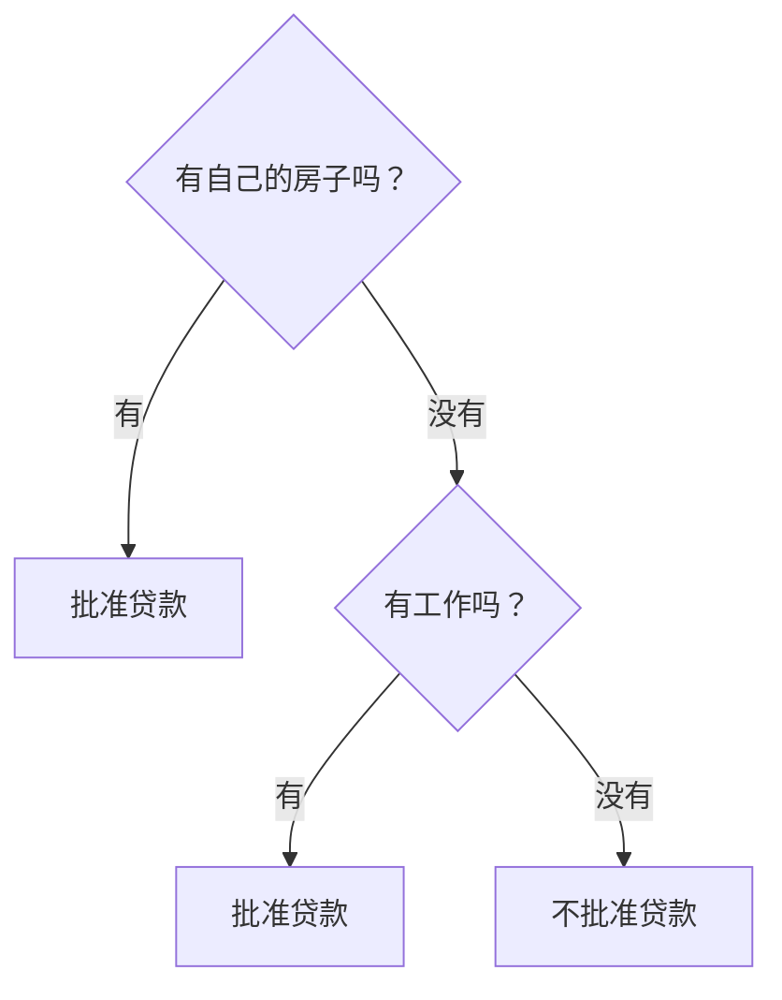
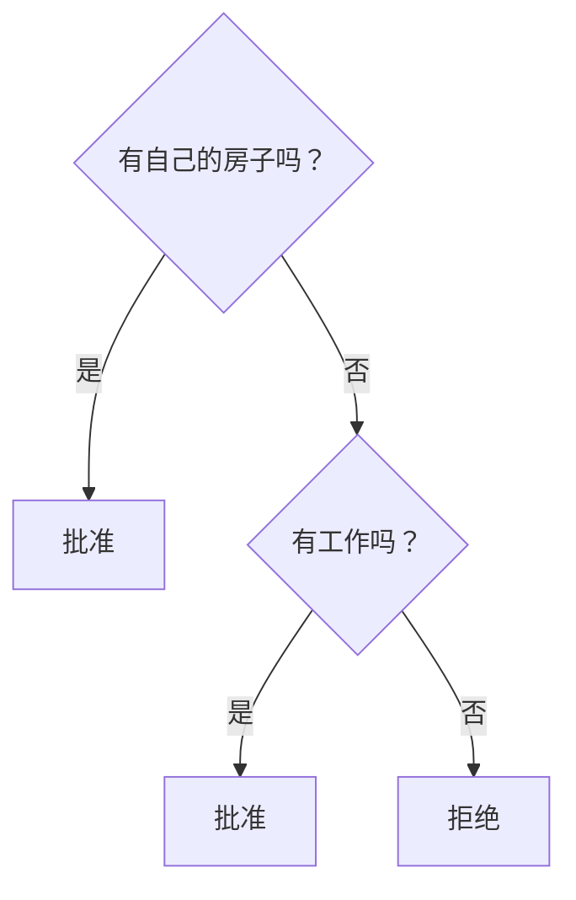
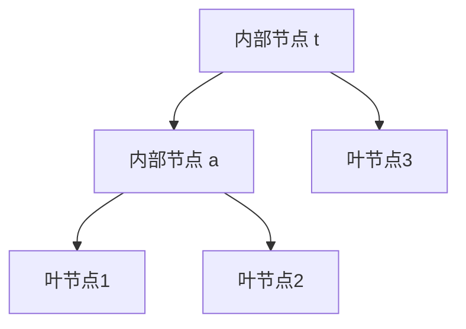

## 一、决策树要解决什么问题

机器学习中有一类问题叫作**监督学习**：我们手里有一些已知答案的数据，希望机器从中总结规律，遇到新数据时能够给出预测。

例如，一个银行积累了若干贷款申请记录。每条记录包含申请人的年龄、是否有工作、是否有自己的房子、信用情况，以及过去是否批准了贷款。我们想把这些记录交给机器，让它学会判断新申请应该属于“批准”还是“不批准”这两个类别。

决策树的做法很像一个不断提问的人：

1. 先问一个对判断结果很有帮助的问题。
2. 根据答案，把人分成不同的小组。
3. 如果某组已经很容易判断，就直接给出结论。
4. 如果某组仍然分不清，就继续问下一个问题。

一棵可能的树长这样：



拿三个新申请人试试看：

- 小明有房子，但没有工作：沿着第一个问题的“有”分支走，预测批准。
- 小红没有房子，但有工作：先走“没有”，再走“有”，预测批准。
- 小刚既没有房子，也没有工作：连续走两个“没有”，预测不批准。

这就是决策树的直觉：**把数据按特征逐层划分，让每个最终的小组尽可能有明确的预测结果。**

这里的规则只是一份小型教学数据可能学出的结果，并不是现实银行应当采用的放贷政策。真实贷款审批还要考虑法律、合规、公平性和很多其他因素。

决策树可以做两类任务：

- **分类**：预测类别，例如“批准/拒绝”“垃圾邮件/正常邮件”“猫/狗”。
- **回归**：预测数值，例如房价、温度或销售额。回归树也是决策树的一种，后面会专门介绍。

## 二、决策树的结构、规则和概率解释

### 2.1 组成一棵树的几个部件

决策树中通常有以下元素：

| 名称 | 英文 | 通俗解释 |
|---|---|---|
| 根节点 | Root node | 从哪里开始问问题，例如“有房子吗” |
| 内部节点 | Internal node | 还需要继续判断的问题，例如“有工作吗” |
| 分支/有向边 | Branch/Directed edge | 问题的一种答案以及下一步要走的方向 |
| 叶节点 | Leaf node | 不再继续提问，直接给出最终预测的地方 |

这里的“特征”就是数据里能用来提问的属性，例如年龄、面积、工作情况；“类别”是我们要预测的答案，例如是否批准。

### 2.2 决策树就是一组 if-then 规则

从根节点走到一个叶节点，就得到一条规则：

```text
如果 有自己的房子，那么 批准贷款。
如果 没有自己的房子 且 有工作，那么 批准贷款。
如果 没有自己的房子 且 没有工作，那么 不批准贷款。
```

所以，**一棵分类决策树可以写成一组 if-then 规则**。

如果每个节点的所有可能答案都有对应分支，且新样本的必要特征都已知，这组规则具有两个性质：

- **互斥**：一个样本不会同时沿着两条不同的完整路径走到终点。
- **完备**：一个样本一定有一条从根节点到叶节点的路径可以走。

例如，“有房子”和“没有房子”互斥；两种情况合起来又覆盖了是否有房子的所有已知情况。

### 2.3 决策树也可以理解为一组条件概率

设：

- $X$ 表示一个样本的特征，例如年龄、工作、房产等。
- $Y$ 表示样本类别，例如“批准”和“拒绝”。

机器最终想知道的是：

$$
P(Y\mid X)
$$

读作“已知特征 $X$，属于类别 $Y$ 的概率”。

举例：某个叶节点里有10个训练样本，其中9个属于“批准”，1个属于“拒绝”。根据这组训练样本估计：

$$
P(Y=\text{批准}\mid X\text{落入该叶节点})\approx\frac9{10}=0.9
$$

如果要输出一个确定类别，就选择概率最大的类别，也就是“批准”。

需要区分两个概念：

- **叶节点的类别**：通常是样本最多的类别。
- **叶节点的类别概率**：各类别在这个叶节点中的比例估计。

因此，决策树既可以解释为一套判断规则，也可以解释为把特征空间切成若干区域，并在每个区域给出一个类别概率分布。

### 2.4 “划分特征空间”到底是什么意思

假设预测房价时只考虑房屋面积和房龄。把每套房子画成平面上的一个点，横坐标是面积，纵坐标是房龄。

如果第一问是“面积是否大于80平方米”，相当于用一条竖线把平面分成两块。如果某一块再问“房龄是否超过10年”，就相当于用一条横线继续切分。

每问一个问题，就缩小一次可能的区域；每条完整路径对应一个最终区域。这个几何解释对后面的CART回归树尤其有用。

## 三、训练决策树：从一堆数据到一套规则

现在的问题是：机器凭什么知道先问“有没有房子”，而不是先问“年龄”？

它不能靠直觉，需要通过数据计算。

一般的建树过程如下：

1. 把所有训练样本放在根节点。
2. 对每个候选特征，尝试用它把数据分组。
3. 计算哪种分组能让各组的类别更明确。
4. 选出当前最好的特征，形成分支。
5. 在尚未分清的子组里继续重复上述过程。
6. 当满足停止条件时，让当前节点变成叶节点。

但“类别更明确”到底怎样衡量？

这需要一些数学指标。接下来会从信息熵开始，一步步推到信息增益、信息增益比和基尼指数。

还有一个重要特点：多数经典建树算法使用**贪心策略**。每次只选当前最好的划分，而不会事先枚举世界上所有可能的树再找全局最优。

原因是，找一棵整体最优的决策树涉及非常庞大的组合搜索；通常的算法要在计算成本和结果质量之间做取舍。

## 四、完整例子：15位贷款申请人

为了让后面的每个公式都能落在具体数据上，我们固定使用下面这15条教学样本。

有四个输入特征：

- 年龄：青年、中年、老年。
- 有工作：是、否。
- 有自己的房子：是、否。
- 信贷情况：一般、好、非常好。

目标类别只有两个：是否批准贷款。

| 编号 | 年龄 | 有工作 | 有自己的房子 | 信贷情况 | 批准贷款 |
|---:|---|---|---|---|---|
| 1 | 青年 | 否 | 否 | 一般 | 否 |
| 2 | 青年 | 否 | 否 | 好 | 否 |
| 3 | 青年 | 是 | 否 | 好 | 是 |
| 4 | 青年 | 是 | 是 | 一般 | 是 |
| 5 | 青年 | 否 | 否 | 一般 | 否 |
| 6 | 中年 | 否 | 否 | 一般 | 否 |
| 7 | 中年 | 否 | 否 | 好 | 否 |
| 8 | 中年 | 是 | 是 | 好 | 是 |
| 9 | 中年 | 否 | 是 | 非常好 | 是 |
| 10 | 中年 | 否 | 是 | 非常好 | 是 |
| 11 | 老年 | 否 | 是 | 非常好 | 是 |
| 12 | 老年 | 否 | 是 | 好 | 是 |
| 13 | 老年 | 是 | 否 | 好 | 是 |
| 14 | 老年 | 是 | 否 | 非常好 | 是 |
| 15 | 老年 | 否 | 否 | 一般 | 否 |

先数一数最后一列：

- 批准：9人。
- 拒绝：6人。
- 总人数：15人。

我们把这15条训练记录的集合记为 $D$，即：

$$
|D|=15
$$

其中 $\lvert D\rvert$ 表示集合 $D$ 中的样本数量。后面公式里出现的竖线，如 $|D_i|$，也都是“集合里有多少个样本”的意思。

这是整篇教程的核心例子。读到后面的计算时，可以随时回来查看这些原始数据。

## 五、信息熵：怎样用数字表示混乱程度

### 5.1 先不看公式，只看直觉

有三个盒子，每个盒子放10张卡片。红卡代表“批准”，蓝卡代表“拒绝”。

**盒子A：10张红卡，0张蓝卡。**

随便抽一张，你知道一定是红卡。结果完全确定。

**盒子B：9张红卡，1张蓝卡。**

大概率能猜中红卡，但仍然有一点不确定。

**盒子C：5张红卡，5张蓝卡。**

红蓝各占一半，最难猜。

我们希望用一个数字表示“不确定程度”：

$$
\text{盒子A的混乱程度}<\text{盒子B的混乱程度}<\text{盒子C的混乱程度}
$$

这个数字就是**信息熵（entropy）**。

一句话记忆：**熵越大，类别分布越混杂；熵越小，类别越确定。**

### 5.2 信息熵公式

如果一个随机变量 $X$ 可能取 $n$ 个值，第 $i$ 个值出现的概率为 $p_i$，它的熵定义为：

$$
\boxed{H(X)=-\sum_{i=1}^{n}p_i\log_2p_i}
$$

各个符号的意思：

| 符号 | 意思 |
|---|---|
| $H(X)$ | 随机变量 $X$ 的信息熵 |
| $p_i$ | 第 $i$ 种结果出现的概率 |
| $\sum$ | 把所有可能结果的对应项加起来 |
| $\log_2$ | 以2为底的对数 |
| 前面的负号 | 让最终熵为非负数 |

如果你不熟悉对数，可以先记住几个值：

$$
\log_2 1=0,\qquad\log_2\frac12=-1,\qquad\log_2\frac14=-2
$$

为什么用对数？信息论中，一个罕见事件发生时通常会带来更多“意外信息”。事件概率为 $p$ 时，它的信息量可以写为 $-\log_2p$；而熵就是对所有结果的信息量按概率取平均。于是得到 $-\sum p_i\log_2p_i$。

这里的对数底数取2，因此熵的单位可以叫作**比特（bit）**。使用其他底数不会改变在同一底数下对特征优劣的基本比较思路。

特别规定：当 $p_i=0$ 时，$p_i\log p_i$ 按极限记为0。因此某个类别完全没出现，不会导致计算出错。

### 5.3 二分类的熵怎么计算

如果只有“批准”和“拒绝”两类，批准概率为 $p$，拒绝概率就是 $1-p$。公式简化为：

$$
\boxed{H(p)=-p\log_2p-(1-p)\log_2(1-p)}
$$

**情况一：两类各占一半。**

$$
\begin{aligned}
H(0.5)&=-0.5\log_20.5-0.5\log_20.5\\
&=-0.5(-1)-0.5(-1)\\
&=1
\end{aligned}
$$

**情况二：一类占90%，另一类占10%。**

$$
H(0.9)=-0.9\log_20.9-0.1\log_20.1\approx0.469
$$

**情况三：全部属于同一类。**

$$
H(1)=0
$$

所以，对于二分类：

- $p=0$ 或 $p=1$ 时，熵为0，完全确定。
- $p=0.5$ 时，熵为1，最不确定。
- $p$ 越接近0.5，类别越混杂；越靠近0或1，类别越纯净。

多分类时同理，只不过熵的最大值是 $\log_2K$，其中 $K$ 是类别数量，最大值出现在各类概率相同时。

### 5.4 计算15位贷款申请人的原始熵

现在回到数据集 $D$。批准占 $9/15$，拒绝占 $6/15$。

$$
\begin{aligned}
H(D)
&=-\frac9{15}\log_2\frac9{15}-\frac6{15}\log_2\frac6{15}\\
&\approx0.971
\end{aligned}
$$

这个0.971的意思是：**在还没有询问任何特征的时候，贷款结果有较高的不确定性。**

下一步要做的事，就是找到一个问题，把这0.971尽可能明显地降下来。

## 六、条件熵和信息增益：怎样选择第一个问题

### 6.1 条件熵是什么

假设先问：“有自己的房子吗？”

15个人被分成两组：

| 组别 | 人数 | 批准 | 拒绝 | 组内熵 |
|---|---:|---:|---:|---:|
| 有房子 | 6 | 6 | 0 | 0 |
| 没房子 | 9 | 3 | 6 | 约0.918 |

有房子这组全部批准，已经没有混乱，所以熵为0。

没房子这组，批准概率为 $3/9$，拒绝概率为 $6/9$，因此：

$$
\begin{aligned}
H(D_{\text{无房}})
&=-\frac39\log_2\frac39-\frac69\log_2\frac69\\
&\approx0.918
\end{aligned}
$$

但是，我们需要一个数字评价“按有无房子分组”之后整体还剩多少混乱。此时不能简单计算 $(0+0.918)/2$，因为两个组人数不同。

正确做法是**按照每组样本数占总样本数的比例，加权平均**：

$$
\begin{aligned}
H(D\mid\text{房子})
&=\frac6{15}\times0+\frac9{15}\times0.918\\
&\approx0.551
\end{aligned}
$$

这就是**条件熵**。

通俗理解：**知道了一个特征，并按该特征分组后，对类别仍然有多少不确定性。**

一般公式是：

$$
\boxed{H(D\mid A)=\sum_{i=1}^{n}\frac{|D_i|}{|D|}H(D_i)}
$$

其中：

- $A$：用来分组的特征。
- $D_i$：按照特征 $A$ 的第 $i$ 个取值分出来的子集。
- $|D_i|/|D|$：该子集所占的样本比例。
- $H(D_i)$：该子集内部类别的熵。

计算时只需记住：**先算各组的熵，再按组的大小加权。**

### 6.2 信息增益是什么

原来的熵是：

$$
H(D)=0.971
$$

知道有无房子之后，条件熵是：

$$
H(D\mid\text{房子})=0.551
$$

减少了多少？

$$
0.971-0.551=0.420
$$

这0.420就是“有自己的房子”这个特征带来的**信息增益（information gain）**。

一般公式：

$$
\boxed{g(D,A)=H(D)-H(D\mid A)}
$$

它等于：

> 分组前的不确定性 − 分组后的平均不确定性。

因此：**信息增益越大，说明这个特征越能帮助我们区分类别。**

信息论里，类别 $Y$ 和特征 $A$ 之间的这个差值也可以理解为互信息 $I(Y;A)$ 的经验估计。

### 6.3 如果先问“有工作吗”呢

根据原始数据：

- 有工作的5个人全部批准，组内熵为0。
- 没工作的10个人中，4人批准、6人拒绝。

没工作的组内熵为：

$$
H(D_{\text{无工作}})
=-\frac4{10}\log_2\frac4{10}-\frac6{10}\log_2\frac6{10}
\approx0.971
$$

按工作分组后的条件熵：

$$
H(D\mid\text{工作})
=\frac5{15}\times0+\frac{10}{15}\times0.971
\approx0.647
$$

信息增益：

$$
g(D,\text{工作})=0.971-0.647\approx0.324
$$

“有工作”也能减少混乱，但效果不如“有自己的房子”：

$$
0.324<0.420
$$

### 6.4 四个特征都算一遍

同样地，可以把“年龄”和“信贷情况”也按各自取值分组，得到：

| 特征 | 分组后的条件熵（约） | 信息增益（约） |
|---|---:|---:|
| 年龄 | 0.888 | 0.083 |
| 有工作 | 0.647 | 0.324 |
| 有自己的房子 | **0.551** | **0.420** |
| 信贷情况 | 0.608 | 0.363 |

第一层应该选择哪个特征？

答案是**有自己的房子**，因为它的信息增益最大。

不难理解：只问一个“有没有房子”，有房子的6个人就已经全部分清；剩下9个人还需要进一步判断。

### 6.5 “经验熵”与“经验条件熵”是什么意思

如果我们知道真实世界中每种结果的准确概率，计算出的就是理论上的熵。

但实际机器学习一般不知道真实概率，只能用训练数据估计。例如15人里9人批准，就估计批准概率为 $9/15$。

使用这种从样本估计出来的概率计算得到的熵，叫作**经验熵**；由样本分组比例计算的条件熵，叫作**经验条件熵**。

名字听起来复杂，实质就是：**概率不是凭空已知的，而是用手头数据的频率估出来的。**

## 七、信息增益比：为什么要惩罚分得太碎的特征

### 7.1 信息增益的一个缺点

假设除了年龄、工作和房产，我们还把每个人的“唯一编号”作为一个特征。

因为每个人编号不同，按编号分组会产生15个小组，每组只有1个人。每组的类别都确定，熵为0。

因此这个特征的信息增益会达到原始熵：

$$
g(D,\text{编号})=H(D)-0=0.971
$$

这比“有自己的房子”的0.420还大。

可编号只是一个身份标识，对从没见过的新申请人通常没有预测意义。这里暴露了信息增益的偏好：**它倾向于选择取值种类较多、可以把训练数据分得很碎的特征。**

### 7.2 信息增益比的公式

为了校正这种偏好，可以引入**信息增益比（information gain ratio）**：

$$
\boxed{g_R(D,A)=\frac{g(D,A)}{H_A(D)}}
$$

分子还是信息增益；分母 $H_A(D)$ 是特征 $A$ 自身取值分布的熵：

$$
H_A(D)=-\sum_{i=1}^{n}\frac{|D_i|}{|D|}\log_2\frac{|D_i|}{|D|}
$$

怎么理解分母？

- 一个特征只有少数几种取值，分母可能较小。
- 一个特征有很多种取值，而且各取值的样本分布比较均匀，分母就可能很大。

用信息增益除以它，就能惩罚一部分“单靠取值很多而获得高信息增益”的特征。

例如15个编号各出现1次，编号特征的熵为：

$$
H_{\text{编号}}(D)=-15\times\frac1{15}\log_2\frac1{15}=\log_2 15\approx3.907
$$

编号的信息增益比约为：

$$
g_R(D,\text{编号})=\frac{0.971}{3.907}\approx0.249
$$

而“有自己的房子”这个特征，两组分别有6人和9人，其取值熵为：

$$
H_{\text{房子}}(D)
=-\frac6{15}\log_2\frac6{15}-\frac9{15}\log_2\frac9{15}
\approx0.971
$$

对应的信息增益比：

$$
g_R(D,\text{房子})\approx\frac{0.420}{0.971}\approx0.433
$$

这时房产特征就明显优于没有泛化意义的编号。

信息增益比并非完美指标，它可能反过来偏好取值较少的特征。实际的C4.5通常还会结合信息增益等条件筛选候选特征，不能简单理解为“只看一个分数就永远没有问题”。

## 八、ID3算法：一步步把树长出来

前面解决了“怎样评价一个特征好不好”的问题。现在把这个评价方法写成真正的建树算法。

### 8.1 ID3的核心规则

**在当前节点，计算所有候选特征的信息增益，选择信息增益最大的那个特征进行划分。然后对子节点重复这个过程。**

这里的“当前节点”很重要：进入某个子节点后，只考虑流入这个子节点的那部分训练数据，而不是每次都重新拿全部15个人计算。

### 8.2 第一步：选择根节点

我们已经算过全部15人的信息增益：

| 特征 | 信息增益 |
|---|---:|
| 年龄 | 0.083 |
| 有工作 | 0.324 |
| 有自己的房子 | **0.420** |
| 信贷情况 | 0.363 |

于是根节点选择“有自己的房子”。

它产生两个分支：

- 有房子：6个人全部批准，可以直接形成“批准”叶节点。
- 没房子：9个人中3人批准、6人拒绝，还不能直接给出足够明确的结论。

### 8.3 第二步：只在“没有房子”的9个人中继续选择

记这9个人构成的子数据集为 $D_2$。现在：

$$
H(D_2)=-\frac39\log_2\frac39-\frac69\log_2\frac69\approx0.918
$$

“有自己的房子”已经在上一层使用过，因此这里考虑剩下的三个特征：年龄、工作、信贷情况。

计算得到：

| 在 $D_2$ 中考虑的特征 | 信息增益（约） |
|---|---:|
| 年龄 | 0.251 |
| 有工作 | **0.918** |
| 信贷情况 | 0.474 |

“有工作”的信息增益达到0.918，恰好等于当前整个子集的熵。这意味着一问“有没有工作”，剩余的混乱就全部消除了。

核对原始数据：

- 没房子但有工作：编号3、13、14，共3人，全部批准。
- 没房子又没工作：其余6人，全部拒绝。

所以再分一次就结束了。完整树为：



注意，ID3并不要求把所有特征都用上。这里没有使用年龄和信贷情况，因为只靠房产、工作两个特征就能把训练样本分清。

### 8.4 算法什么时候停止

递归地划分总要有停止条件，常见情况包括：

1. **当前数据全部属于同一类别**：直接建立该类别的叶节点。
2. **没有剩余候选特征**：把当前样本中占比最高的类别作为叶节点结果。
3. **最优信息增益也很小**：继续划分没有太大价值，可以设置阈值 $\varepsilon$，当 $\max_A g(D,A)<\varepsilon$ 时停止，输出多数类。

没有任何特征能够区分的两条训练样本，可能仍然拥有不同标签。此时决策树无法凭空制造新的信息，只能采用多数类等策略给出预测。

### 8.5 用伪代码理解ID3

```text
建立决策树(数据集D, 候选特征集合A):
    如果D里的样本全部属于同一类别:
        返回该类别的叶节点

    如果A为空:
        返回D中多数类别对应的叶节点

    对A中的每一个特征计算信息增益
    找到信息增益最大的特征A_best

    如果信息增益小于停止阈值:
        返回D中多数类别对应的叶节点

    创建一个以A_best为判断问题的内部节点
    对A_best的每种取值:
        取出与该值对应的子数据集
        对该子数据集递归调用“建立决策树”

    返回建立好的树
```

这里省略了空分支、缺失值等工程细节，但已经包含ID3的核心逻辑。

### 8.6 为什么说建树是“局部最优”

假设根节点有两个候选特征。A带来的当前信息增益比B高，于是贪心算法选择A。但未来继续划分后，以B开头的整棵树可能更浅，或者在测试数据上的表现更好。

ID3在根节点并不知道未来所有分支的结果。它只选择当前看起来最有效的问题，所以叫作**局部贪心选择**。

这并不等于算法没有用。相反，贪心选择让决策树能以可接受的计算成本，得到通常相当有用的模型。

## 九、C4.5算法：对ID3的改进

### 9.1 为什么要改进ID3

我们前面看到，如果某个特征拥有大量不同取值，例如唯一编号，信息增益可能很高，却无法很好地预测未来数据。

所以C4.5保留了“自上而下、递归分组”的基本思路，但改进了选择分裂特征的标准。

它使用的信息增益比为：

$$
g_R(D,A)=\frac{H(D)-H(D\mid A)}{H_A(D)}
$$

分母的存在，让多取值特征不再可以只依靠“把训练样本分得特别碎”轻易获胜。

### 9.2 C4.5的建树步骤

它和ID3很像：

1. 检查当前数据是否已经足够纯净。
2. 评价剩余候选特征。
3. 按信息增益比等准则选择合适的划分特征。
4. 根据所选特征划分数据。
5. 对子数据集继续递归。

因为核心建树方式类似，理解了ID3后，理解C4.5主要需要把握**评价特征的指标变了**。

在完整算法中，C4.5还可以处理连续属性、缺失值，并配合剪枝技术。不同教材的精简版实现不一定覆盖这些细节；这里重点讨论它的特征选择思想。

### 9.3 一个容易混淆的问题

“信息增益大”与“信息增益比大”不是同一回事。信息增益直接看不确定性减少多少，信息增益比还会考虑特征取值分布的分散程度。

因此，两套指标有可能选择不同的根节点；它们的结果并不需要始终一致。

## 十、过拟合与剪枝：为什么树不能无限生长

### 10.1 训练准确率高，不代表预测新数据一定好

想象两位学生准备数学考试：

- 学生甲把练习册每道题的答案都背下来。
- 学生乙弄懂了题型和解法，即使练习中偶尔出错，也能够应对新题。

决策树也可能像学生甲一样“死记硬背”训练数据。

例如，数据里恰好有一位特征很特殊的申请人。如果我们为了让这一个训练样本也被正确分类，继续增加很多细碎分支，树在训练集上可能100%正确，但对新申请人反而判断得不稳。

这就叫作**过拟合（overfitting）**：模型对训练数据拟合得过度，学习到了偶然噪声或特殊细节，泛化到未知样本时效果变差。

反过来，树如果只有一个叶节点，对所有人一律作出相同判断，通常又太简单。这种无法学到足够规律的情况叫作**欠拟合（underfitting）**。

所以真正的目标不是“树越深越好”，也不是“树越浅越好”，而是**树的复杂程度适合当前问题**。

### 10.2 两种抑制复杂度的方法

**预剪枝（pre-pruning）**：建树时就设限。比如节点样本太少时不再划分、树达到最大深度就停止、信息增益太小时停止。

**后剪枝（post-pruning）**：先长出一棵比较完整的树，再检查哪些分支没有足够价值，把它们删掉。

这两种方法都是为了解决过拟合，只是干预的阶段不同。

### 10.3 损失函数为什么加上复杂度惩罚

只看训练损失，复杂树往往更容易占优势：它可以不断细分训练数据，甚至记住异常样本。

于是引入**代价复杂度损失**：

$$
\boxed{C_\alpha(T)=C(T)+\alpha|T|}
$$

其中：

- $T$：一整棵决策树。
- $C(T)$：这棵树对训练数据的拟合损失。
- $\lvert T\rvert$：叶节点数量，用来衡量树的复杂度。
- $\alpha\ge0$：复杂度惩罚系数。

可以把这个公式理解为：

> 总成本 = 预测不准确的成本 + 树太复杂的成本。

如果 $\alpha=0$，就不惩罚叶节点数量，树可能很大。

如果 $\alpha$ 很大，增加叶节点的代价很高，模型更倾向于一棵小树。

这里的 $C(T)$ 可以基于不同的训练损失定义。比如，在使用经验熵的一个分类树剪枝形式中：

$$
C(T)=\sum_{\ell\in\mathcal L(T)}N_\ell H_\ell
$$

这里 $\mathcal L(T)$ 是叶节点集合，$N_\ell$ 是进入叶节点 $\ell$ 的训练样本数，$H_\ell$ 是该叶节点内的类别熵。

直观地看，一个叶节点内样本越混杂，它带来的分类损失越大；叶节点越多，复杂度惩罚也越大。

回归树常使用平方误差之和作为 $C(T)$；有些分类树剪枝方法使用错分误差。不同损失的数值尺度可以不同，但代价复杂度的数学结构保持相同。

### 10.4 用数字看“准确”与“简单”的权衡

假设两棵候选树：

| 项目 | 树A | 树B |
|---|---:|---:|
| 训练损失 $C(T)$ | 2 | 3 |
| 叶节点数量 $\lvert T\rvert$ | 10 | 4 |

若 $\alpha=0.5$：

$$
C_{0.5}(A)=2+0.5\times10=7
$$

$$
C_{0.5}(B)=3+0.5\times4=5
$$

树A的训练损失更小，但树B在这个复杂度惩罚下的综合损失更小，因此树B更合适。

这些数字只是帮助理解公式的例子，并非某个真实实验的结果。

## 十一、CART分类树：用基尼指数决定怎样分

### 11.1 CART和前两种算法的主要区别

CART是 **Classification and Regression Tree** 的缩写，中文叫“分类与回归树”。

它既可以做分类，也可以做回归。最重要的结构特点是：**CART生成的是二叉树，每个内部节点都恰好进行一次二分。**

例如，年龄有青年、中年、老年三个取值：

- ID3的简单多叉划分可以一次产生青年、中年、老年三个分支。
- CART可以考虑“青年/非青年”“中年/非中年”等二分方式，每次只保留两条分支。

对连续数值特征，比如面积，可以提出“面积 $\le80$ 平方米吗”这样的二元问题。

### 11.2 基尼指数：另一种混乱程度指标

CART分类树通常用**基尼指数（Gini impurity）**评价分组是否纯净。

假设有 $K$ 个类别，第 $k$ 类的比例为 $p_k$，定义：

$$
\boxed{\operatorname{Gini}(D)=1-\sum_{k=1}^{K}p_k^2}
$$

二分类时，某一类概率为 $p$，另一类为 $1-p$：

$$
\begin{aligned}
\operatorname{Gini}(p)
&=1-p^2-(1-p)^2\\
&=1-p^2-(1-2p+p^2)\\
&=2p-2p^2
\end{aligned}
$$

因此：

$$
\boxed{\operatorname{Gini}(p)=2p(1-p)}
$$

看看三个例子：

| 类别比例 | 基尼指数 | 意味着什么 |
|---|---:|---|
| 100%和0% | 0 | 完全纯净 |
| 90%和10% | 0.18 | 比较纯净 |
| 50%和50% | 0.5 | 二分类中最混杂 |

它和信息熵的变化规律相似，但数值尺度不同。比如50%对50%时，熵等于1，基尼指数等于0.5。

两者都是“越小越纯净”，只是具体计算方法不同。

### 11.3 CART怎样评价一次二分

假设某个划分方案把数据集 $D$ 分成 $D_1$ 和 $D_2$。划分后的加权基尼指数是：

$$
\boxed{
\operatorname{Gini}(D,A)
=\frac{|D_1|}{|D|}\operatorname{Gini}(D_1)
+\frac{|D_2|}{|D|}\operatorname{Gini}(D_2)
}
$$

这和计算条件熵的结构很像：

1. 先分别计算两个子组的基尼指数。
2. 再按子组样本比例加权平均。
3. 选择**加权基尼指数最小**的划分。

注意区分两个方向：

- ID3比较信息增益，**越大越好**。
- CART分类树比较划分后的加权基尼指数，**越小越好**。

### 11.4 用15人贷款数据计算基尼指数

最初9人批准、6人拒绝，原始基尼指数为：

$$
\begin{aligned}
\operatorname{Gini}(D)
&=1-\left(\frac9{15}\right)^2-\left(\frac6{15}\right)^2\\
&=1-0.36-0.16\\
&=0.48
\end{aligned}
$$

现在尝试按“有自己的房子”二分：

- 有房子：6人全部批准，基尼指数0。
- 没房子：9人中3人批准、6人拒绝。

没房子这组的基尼指数：

$$
\operatorname{Gini}(D_{\text{无房}})
=1-\left(\frac39\right)^2-\left(\frac69\right)^2
=\frac49\approx0.444
$$

加权得到：

$$
\begin{aligned}
\operatorname{Gini}(D,\text{房子})
&=\frac6{15}\times0+\frac9{15}\times\frac49\\
&=\frac4{15}\approx0.267
\end{aligned}
$$

使用这组数据，对每个特征的所有候选二分方案进行比较，可以得到以下最优划分后的基尼指数：

| 特征 | 该特征最佳二分的加权基尼指数（约） |
|---|---:|
| 年龄 | 0.44 |
| 有工作 | 0.32 |
| 有自己的房子 | **0.27** |
| 信贷情况 | 0.32 |

所以CART也会优先问“有没有自己的房子”。但要注意，这是因为这份数据恰好如此；换一份数据，ID3和CART完全可能得到不同的树。

### 11.5 CART怎样寻找切分点

对于二值特征（是否有房子），切分方式比较直接。

对于有多个取值的类别特征，CART需要比较不同的二分方案。对于连续特征，它还要寻找合适的数值阈值。

例如年龄是具体数值 $23,28,35,42,57$，可以考虑：

```text
年龄 <= 25.5 ?
年龄 <= 31.5 ?
年龄 <= 38.5 ?
年龄 <= 49.5 ?
```

把样本按候选阈值分成两组，分别计算加权基尼指数，最后选最小的一种。

随着递归进行，每个新节点都重复这一过程，直到满足停止条件，例如当前节点已足够纯净、样本太少或树已达到设定深度。

## 十二、CART回归树：怎样预测一个数值

### 12.1 回归树的叶节点为什么是数字

分类树最后输出“批准”或“拒绝”，回归树最后输出具体数值。

比如预测房价，我们有4条训练数据：

| 房屋面积 | 真实房价 |
|---:|---:|
| 60㎡ | 100万元 |
| 70㎡ | 120万元 |
| 90㎡ | 200万元 |
| 110㎡ | 240万元 |

假设按面积是否超过80㎡二分：

第一组是60㎡和70㎡，其平均房价为：

$$
c_1=\frac{100+120}{2}=110\text{万元}
$$

第二组是90㎡和110㎡，其平均房价为：

$$
c_2=\frac{200+240}{2}=220\text{万元}
$$

于是回归树形成一条简单规则：

```text
如果面积 <= 80㎡，预测房价110万元。
如果面积 > 80㎡，预测房价220万元。
```

为什么每组取平均值？因为当用一个固定数字预测这一组所有训练样本、并以平方误差之和衡量损失时，最优的固定数字就是这一组目标值的平均数。

### 12.2 什么是平方误差

假设真实房价为120万元，预测为110万元，误差是：

$$
120-110=10\text{万元}
$$

平方误差为：

$$
(120-110)^2=100
$$

如果预测200万元而真实只有120万元，平方误差就是：

$$
(120-200)^2=6400
$$

可见，偏差越大，平方误差增长得越快。

对一个叶节点内所有样本，平方误差之和为：

$$
\operatorname{SSE}=\sum_{i\in\text{该叶节点}}(y_i-c)^2
$$

其中 $y_i$ 是真实数值，$c$ 是这个叶节点给出的统一预测值。

### 12.3 为什么要选择合适的切分阈值

如果按80㎡二分：

第一组的平方误差和：

$$
(100-110)^2+(120-110)^2=200
$$

第二组的平方误差和：

$$
(200-220)^2+(240-220)^2=800
$$

所以总平方误差为：

$$
200+800=1000
$$

如果换成“面积是否超过65㎡”，第一组只有100万元这一条记录；第二组的房价是120、200、240万元，平均约186.67万元。总平方误差会变成约7466.67，明显更大。

因此，80㎡这个阈值比65㎡更好。

真正的CART回归算法会考虑不同特征和不同切分点，寻找使平方误差之和最小的方案。

### 12.4 CART回归树的优化公式

设用第 $j$ 个特征的阈值 $s$ 将数据分成两组：

$$
R_1(j,s)=\{x:x^{(j)}\le s\}
$$

$$
R_2(j,s)=\{x:x^{(j)}>s\}
$$

这里 $x^{(j)}$ 表示样本 $x$ 的第 $j$ 个特征。

我们要选择 $j,s$ 和两组各自的预测值 $c_1,c_2$，让下面的量最小：

$$
\boxed{
\min_{j,s}\left[
\min_{c_1}\sum_{x_i\in R_1(j,s)}(y_i-c_1)^2
+\min_{c_2}\sum_{x_i\in R_2(j,s)}(y_i-c_2)^2
\right]
}
$$

不要被双重最小化吓住。它只是说：

1. 假设先选一个特征和一个切分点。
2. 分别求左右两组的最佳预测值（也就是两组各自的平均值）。
3. 计算两组的平方误差之和。
4. 换一个切分点重复计算。
5. 选择总平方误差最小的方案，再对子组继续递归。

分类CART和回归CART的树形结构相同，主要差别在于：**分类用类别纯度判断怎样切，回归用数值预测误差判断怎样切。**

## 十三、CART代价复杂度剪枝：完整理解$g(t)$

这是理解CART算法时最容易卡住的一部分。我们会先看直觉，再解释每个符号，然后一步步推导公式，最后用数字说明为什么每次要剪 $g(t)$ 最小的子树。

### 13.1 剪枝面临的两难选择

假设某个节点下面已经长出一棵复杂的子树。它用好几个问题一步步判断样本。

现在有两个选择：

**选择A：保留子树。**

优点是更贴合训练数据，通常训练误差较小；缺点是叶节点较多，结构复杂。

**选择B：剪掉子树。**

把子树下面的所有分支删掉，让子树的根节点直接变成一个叶节点。优点是结构简单；缺点是许多本来分开的样本现在必须采用同一种预测，训练误差可能增加。

剪枝要解决的就是：**训练误差多增加一点，能换来多少复杂度的下降？这个交换值不值得？**

### 13.2 两个很容易混淆的记号：t和T_t

假设一棵树的某个部分如下：



- 小写 $t$：我们正在考虑的一个内部节点。
- 大写 $T_t$：以 $t$ 为根的**整棵子树**，包括它下面的所有节点和分支。

如果把 $T_t$ 剪掉，保留的不是空白，而是一个单独的叶节点 $t$。这和直接把整个区域从世界上删除是两回事。

### 13.3 $C(t)$和$C(T_t)$分别是什么

**$C(t)$：把节点 $t$ 变成一个叶节点之后，这一部分数据的训练损失。**

例如，20个样本来到节点 $t$，其中15个是A类、5个是B类。若直接让 $t$ 作为叶节点，预测所有样本都是A类，那么有5个样本会错分。

如果暂时用“错分样本数”衡量损失，可以写：

$$
C(t)=5
$$

**$C(T_t)$：保留以 $t$ 为根的整棵子树时，这一部分数据的总训练损失。**

假设子树继续问问题，分到3个叶节点以后，只错分1个样本，那么：

$$
C(T_t)=1
$$

所以：

$$
C(t)-C(T_t)=5-1=4
$$

这表示：**如果把子树压缩成一个叶节点，训练损失将增加4。**

这里用错分数量举例是为了让计算直观。实际剪枝可以使用统一定义的其他训练损失，例如叶节点经验熵加权和。关键是比较时前后采用同一种损失口径。

### 13.4 为什么分母是|T_t|−1

设原来的子树有3个叶节点：

$$
|T_t|=3
$$

剪枝后，整个子树压缩成节点 $t$，它现在是**1个叶节点**。

因此叶节点从3个变成1个，实际减少了：

$$
3-1=2
$$

一般来说，叶节点减少量为：

$$
\boxed{|T_t|-1}
$$

注意，$|T_t|$ 统计的是子树的**叶节点个数**，并不是包括内部节点在内的所有节点个数。

为什么不能直接除以 $|T_t|$？因为剪枝以后还剩下节点 $t$ 这个新叶节点，并不是把原来的叶节点数全部减少为0。

### 13.5 $g(t)$的直观含义

现在把分子和分母组合：

$$
\boxed{g(t)=\frac{C(t)-C(T_t)}{|T_t|-1}}
$$

它等于：

$$
\boxed{
\frac{\text{剪枝增加的训练损失}}{\text{剪枝减少的叶节点数量}}
}
$$

也就是：**每减少一个叶节点，平均要牺牲多少训练集上的拟合效果。**

代入刚才的数字：

$$
g(t)=\frac{5-1}{3-1}=2
$$

这意味着，把这段子树剪掉，每减少一个叶节点，平均要增加2个单位的训练损失。

想象两棵候选子树：

- 子树A：每减少一个叶节点，就要增加10个单位的训练损失。
- 子树B：每减少一个叶节点，只增加1个单位的训练损失。

如果想简化整棵树，显然子树B更适合优先考虑剪掉。它损失的拟合效果相对较小，却能节省复杂度。

但“比较每个叶节点的平均代价”还不是完整的数学理由。下一步才是这个公式的关键。

### 13.6 $g(t)$为什么恰好是剪枝的临界值

先回顾代价复杂度损失：

$$
C_\alpha(T)=C(T)+\alpha|T|
$$

现在只比较节点 $t$ 下面这部分结构。树的其他部分无论怎么选都不变，比较时可以抵消。

**第一种方案：保留子树 $T_t$。**

保留时，子树训练损失是 $C(T_t)$，叶节点有 $|T_t|$ 个，因此：

$$
\boxed{C_\alpha(T_t)=C(T_t)+\alpha|T_t|}
$$

**第二种方案：把子树剪成一个叶节点 $t$。**

剪枝后训练损失是 $C(t)$，叶节点只有一个，因此：

$$
\boxed{C_\alpha(t)=C(t)+\alpha}
$$

什么时候应该剪枝？

当剪枝后的综合损失更小时，即：

$$
C_\alpha(t)<C_\alpha(T_t)
$$

把两个公式代进去：

$$
C(t)+\alpha<C(T_t)+\alpha|T_t|
$$

把训练损失移动到左边，把复杂度惩罚移动到右边：

$$
C(t)-C(T_t)<\alpha|T_t|-\alpha
$$

右边提取公因式 $\alpha$：

$$
C(t)-C(T_t)<\alpha(|T_t|-1)
$$

假设此时 $|T_t|>1$，即原来的确有一棵可以剪掉的非平凡子树，两边除以 $|T_t|-1$：

$$
\frac{C(t)-C(T_t)}{|T_t|-1}<\alpha
$$

观察左边，它正是 $g(t)$ 的定义。所以得到：

$$
\boxed{g(t)<\alpha}
$$

这说明，**当复杂度惩罚系数 $\alpha$ 超过 $g(t)$ 时，剪掉子树的综合损失会更小。**

同样地：

$$
\boxed{
\begin{cases}
\alpha<g(t),&\text{保留子树更划算}\\
\alpha=g(t),&\text{保留和剪掉的综合损失相等}\\
\alpha>g(t),&\text{剪掉子树更划算}
\end{cases}}
$$

因此，$g(t)$ 不只是一个“平均损失”，它还是这棵子树**从值得保留变成值得剪掉的临界复杂度惩罚系数**。

从代数上，也可以把两种方案的损失差写成：

$$
\begin{aligned}
C_\alpha(t)-C_\alpha(T_t)
&=C(t)+\alpha-C(T_t)-\alpha|T_t|\\
&=[C(t)-C(T_t)]-\alpha(|T_t|-1)\\
&=(|T_t|-1)[g(t)-\alpha]
\end{aligned}
$$

由于 $|T_t|-1>0$，损失差的正负完全由 $g(t)-\alpha$ 决定。这把前面的三种情况一次解释清楚了。

### 13.7 用具体数值验证临界值

继续使用我们刚才设定的例子：

$$
C(t)=5,\quad C(T_t)=1,\quad |T_t|=3
$$

于是：

$$
g(t)=\frac{5-1}{3-1}=2
$$

保留子树时：

$$
C_\alpha(T_t)=1+3\alpha
$$

剪掉子树时：

$$
C_\alpha(t)=5+\alpha
$$

我们改变 $\alpha$，看看结果：

| $\alpha$ | 保留子树：$1+3\alpha$ | 剪枝：$5+\alpha$ | 谁的综合损失更低 |
|---:|---:|---:|---|
| 0 | 1 | 5 | 保留 |
| 1 | 4 | 6 | 保留 |
| 2 | 7 | 7 | 相等 |
| 3 | 10 | 8 | 剪枝 |
| 4 | 13 | 9 | 剪枝 |

这正好验证了：

- $\alpha<2$：保留子树。
- $\alpha=2$：两者打平。
- $\alpha>2$：剪掉子树。

所以 $g(t)=2$ 就是这棵子树的临界点。

### 13.8 为什么先找$g(t)$最小的节点

一棵完整决策树可能存在很多内部节点，它们分别对应不同的候选子树。

对每个内部节点计算 $g(t)$，假设得到：

| 候选子树 | 剪枝增加的训练损失 | 减少的叶节点数 | $g(t)$ |
|---|---:|---:|---:|
| 以 $t_1$ 为根 | 8 | 2 | 4 |
| 以 $t_2$ 为根 | 3 | 3 | **1** |
| 以 $t_3$ 为根 | 6 | 2 | 3 |

先考虑从 $\alpha=0$ 开始，逐渐增大复杂度惩罚。

当 $0\le\alpha<1$ 时，这三个候选子树都还没到各自的剪枝临界值。

当 $\alpha=1$ 时，$t_2$ 首先达到临界值，剪掉它与保留它的综合损失相同；而 $t_1,t_3$ 仍然值得保留。

因此，**$g(t)$ 最小的子树，是随着 $\alpha$ 增大最先失去保留价值的子树。**

这就是最小代价复杂度剪枝中“优先剪最小 $g(t)$”的原因，通常也称为**弱链接剪枝（weakest-link pruning）**。

“弱链接”的意思不是“它必然预测得最差”，而是：**与它节省的复杂度相比，它带来的额外训练拟合收益最不值得保留。**

### 13.9 完整的CART剪枝算法：产生一系列由大到小的树

理解了临界值和最小 $g(t)$，完整过程就顺理成章。

**第一步：生成一棵比较完整的CART树。**

记作 $T_0$。它往往有较多分支，对训练数据拟合得比较好。

**第二步：计算所有内部节点的 $g(t)$。**

找出最小值：

$$
\alpha_1=\min_{t\in\text{内部节点}}g(t)
$$

这个值是当前树的第一处剪枝临界值。

**第三步：剪去对应的最弱子树。**

将被选中的子树压缩成一个叶节点，得到更小的树 $T_1$。如果出现相同的最小临界值，需要按算法规则处理并列候选，形成相应的下一棵候选树。

**第四步：在新的树上重新计算 $g(t)$。**

因为之前剪掉的分支会改变某些祖先子树的结构和损失，不能简单地把第一次计算的所有分数一直用到底。

再次找到最小临界值，继续剪枝，得到 $T_2$。

不断重复：

$$
\boxed{T_0\supset T_1\supset T_2\supset\cdots\supset T_m}
$$

这里的包含符号表示：后一棵树是前一棵树通过剪枝得到的子树结构。随着过程推进，树越来越简单，最终可能只剩根节点。

同时得到一系列临界惩罚系数：

$$
0\le\alpha_1\le\alpha_2\le\cdots\le\alpha_m
$$

直观地看：随着我们越来越不能容忍复杂的树，最优的候选结构会在这些临界点发生变化。

**第五步：利用验证数据或交叉验证选择真正合适的树。**

这一步很重要，因为**剪得越多并不意味着预测一定越好**。

假设得到几棵候选树：

| 候选树 | 叶节点数 | 训练准确率 | 验证准确率 |
|---|---:|---:|---:|
| $T_0$ | 20 | 99% | 82% |
| $T_1$ | 15 | 97% | 86% |
| $T_2$ | 8 | 94% | **90%** |
| $T_3$ | 4 | 87% | 85% |
| $T_4$ | 1 | 60% | 59% |

*本表是为了解释选择逻辑而设定的示意数据，并非真实实验结果。*

可以看到，$T_0$ 训练成绩很高，但验证成绩不理想，可能过拟合；$T_4$ 太简单，可能欠拟合；$T_2$ 的验证表现最好。

所以最后选择 $T_2$，而不是最复杂的树，也不是最简单的树。

### 13.10 $g(t)$和信息增益有什么不同

之前也有一个叫 $g$ 的公式：

$$
g(D,A)=H(D)-H(D\mid A)
$$

现在剪枝又出现：

$$
g(t)=\frac{C(t)-C(T_t)}{|T_t|-1}
$$

虽然符号相同，但含义不同：

| 项目 | 信息增益 $g(D,A)$ | 剪枝参数 $g(t)$ |
|---|---|---|
| 发生在什么阶段 | 建树 | 剪枝 |
| 解决什么问题 | 哪个特征最值得拿来分组 | 哪棵子树最先不值得保留 |
| 衡量什么 | 划分后不确定性减少多少 | 每减少一个叶节点，训练损失增加多少 |
| 选择方向 | 越大越优先 | 越小越先到达剪枝临界点 |

可以把两个阶段记为：

- **建树时问：多加一个判断问题能带来多少好处？**
- **剪枝时问：少保留一些判断问题会损失多少好处？**

### 13.11 用生活比喻再理解一次

把决策树想象成一个公司的管理结构。某个部门下面有3个小组。保留3个小组，工作损失很低，但管理结构复杂；合并成1个小组，管理简单，但工作质量可能下降。

假设保留时的损失是1，合并后的损失是5。合并减少了2个小组，所以每减少一个小组的平均损失是：

$$
\frac{5-1}{3-1}=2
$$

如果公司对“少一个小组”的简化收益赋予的价值超过2个损失单位，合并就是划算的。

映射回CART：

- 小组对应叶节点。
- 工作质量损失对应训练损失。
- 减少管理层级的收益对应复杂度惩罚。
- 每减少一个小组的平均代价对应 $g(t)$。
- 公司愿意为结构简化付出的权重对应 $\alpha$。

这就是CART代价复杂度剪枝的本质：**用一个明确的损失函数，衡量“更简单”是否值得“训练拟合变差”这个代价。**

## 十四、三种算法的比较和整套学习流程

### 14.1 ID3、C4.5、CART放在一起比较

| 项目 | ID3 | C4.5 | CART |
|---|---|---|---|
| 典型特征选择标准 | 信息增益最大 | 信息增益比（常结合增益筛选） | 分类用基尼指数最小；回归用平方误差最小 |
| 树形结构 | 可以多叉 | 可以多叉 | 二叉树 |
| 分类 | 可以 | 可以 | 可以 |
| 回归 | 经典ID3不用于此 | 经典C4.5主要用于分类 | 可以 |
| 核心特点 | 简洁的递归分类树算法 | 缓解信息增益对多取值特征的偏好 | 统一处理分类与回归，配有代价复杂度剪枝 |

记忆时可以先抓住最有辨识度的部分：

- **ID3：信息增益。**
- **C4.5：信息增益比。**
- **CART分类：基尼指数。**
- **CART回归：平方误差。**
- **CART剪枝：代价复杂度与 $g(t)$。**

但不要把“分裂标准”和“剪枝标准”混为一谈。建树时使用基尼指数，不代表剪枝公式中的 $C(T)$ 就一定是同一个基尼指数；剪枝会使用明确规定的训练损失及复杂度惩罚。

### 14.2 从零训练一棵树，实际经历什么

不管采用哪种经典算法，可以按下面的顺序理解整个学习过程。

**阶段一：准备训练数据。**

每条数据必须包含可用于预测的特征，以及已知的目标类别或数值。训练数据质量会影响最终模型质量。

**阶段二：选择分裂指标。**

分类ID3选择信息增益，C4.5选择信息增益比，CART分类选择加权基尼指数，CART回归选择平方误差之和。

**阶段三：生成根节点。**

根据当前全部训练样本，找出最好的第一个判断问题。

**阶段四：递归地继续划分。**

把数据送到相应子节点，在每个子节点重新计算最优划分，直到达到停止条件。

**阶段五：控制复杂度。**

可以在建树过程中限制最大深度、叶节点最少样本数，也可以在建树后剪掉不划算的子树。

**阶段六：用独立数据评价。**

训练集上的表现只是参考。应该使用验证集、交叉验证以及最终未参与调参的测试集，评价模型对新数据的预测能力。

### 14.3 决策树的优点与局限

决策树的优点：

- **容易解释**：可以把预测过程直接写成一连串判断条件。
- **适用范围广**：分类、回归都可以用相应的树模型处理。
- **非线性表达能力较强**：可以通过多次划分形成复杂的判断区域。
- **通常不要求特征标准化**：基于阈值和分组的划分，不像某些距离型模型那样依赖特征量纲。

决策树的局限：

- **容易过拟合**：不限制复杂度时，可能记住训练集里的特殊细节。
- **对数据变化敏感**：少量样本变化有时会导致不同的根节点或不同的树结构。
- **贪心建树并不保证全局最优**：局部最好的切分，不一定组成整体最好的树。
- **预测常呈分段常数形式**：标准回归树在每个叶节点预测一个固定数值，拟合平滑变化关系时可能需要很多叶节点。

真实项目中还要注意缺失值、类别不平衡、特征泄漏和数据偏差。一个看起来很准确的模型，如果训练数据不代表实际应用场景，也可能在部署后失效。

### 14.4 用一句话串起整篇

决策树像一个通过数据学会提问的人。

训练时，它不断寻找一个能够更有效地区分类别、或者减少数值预测误差的问题。每个问题把数据分成更小的小组，直到最终可以直接给出预测。随后，我们还要检查这棵树是否问了太多没有必要的问题，通过限制复杂度或剪枝让它对新数据更可靠。

**建树负责让规则有用，剪枝负责让规则不过度复杂。**

## 十五、公式速查与符号说明

最后把全文的关键公式集中放在一起。

### 15.1 分类中的信息熵

$$
\boxed{H(D)=-\sum_{k=1}^{K}p_k\log_2p_k}
$$

回答：**当前类别分布有多混乱？**

在二分类中，两类各半时熵最大、全部属于同一类时熵为0。

### 15.2 条件熵

$$
\boxed{H(D\mid A)=\sum_i\frac{|D_i|}{|D|}H(D_i)}
$$

回答：**按特征 $A$ 分组以后，平均还剩多少混乱？**

### 15.3 信息增益

$$
\boxed{g(D,A)=H(D)-H(D\mid A)}
$$

回答：**这个问题让混乱减少了多少？**

ID3选择信息增益大的特征。

### 15.4 信息增益比

$$
\boxed{g_R(D,A)=\frac{g(D,A)}{H_A(D)}}
$$

回答：**考虑特征取值分布的分散程度后，这个问题的区分能力如何？**

C4.5的特征选择核心涉及信息增益比。

### 15.5 基尼指数

$$
\boxed{\operatorname{Gini}(D)=1-\sum_{k=1}^{K}p_k^2}
$$

二分类时：

$$
\boxed{\operatorname{Gini}(p)=2p(1-p)}
$$

回答：**这一组样本的类别有多混杂？**

CART分类树选择使划分后加权基尼指数最小的分法。

### 15.6 回归树的平方误差

$$
\boxed{\operatorname{SSE}=\sum_i(y_i-\hat y_i)^2}
$$

回答：**数值预测和真实值总共差了多少？**

标准最小二乘回归树的叶节点输出该组训练目标值的平均数。

### 15.7 代价复杂度损失

$$
\boxed{C_\alpha(T)=C(T)+\alpha|T|}
$$

回答：**预测误差与树的复杂度加在一起，总成本是多少？**

### 15.8 CART剪枝的临界参数

$$
\boxed{g(t)=\frac{C(t)-C(T_t)}{|T_t|-1}}
$$

回答：**把一段子树压缩成一个叶节点时，每减少一个叶节点要增加多少训练损失？**

更进一步，$g(t)$ 是保留与剪掉这段子树综合损失相等时的临界 $\alpha$：

$$
\boxed{
\begin{aligned}
\alpha<g(t)&:\ \text{保留更优}\\
\alpha=g(t)&:\ \text{两者相等}\\
\alpha>g(t)&:\ \text{剪枝更优}
\end{aligned}}
$$

### 15.9 全文常见符号

| 符号 | 含义 |
|---|---|
| $D$ | 训练数据集 |
| $\lvert D\rvert$ | 训练样本个数 |
| $A$ | 一个候选特征 |
| $D_i$ | 按某个特征分出的第 $i$ 个子集 |
| $p_k$ | 第 $k$ 类样本所占比例 |
| $H(D)$ | 类别的信息熵 |
| $H(D\mid A)$ | 按特征 $A$ 分组后的条件熵 |
| $g(D,A)$ | 信息增益 |
| $g_R(D,A)$ | 信息增益比 |
| $T$ | 一整棵决策树 |
| $\lvert T\rvert$ | 整棵树的叶节点数量 |
| $t$ | 某个内部节点，也可表示剪枝后把它作为叶节点 |
| $T_t$ | 以节点 $t$ 为根的子树 |
| $C(t)$ | 把 $t$ 作为叶节点时的训练损失 |
| $C(T_t)$ | 保留整棵子树 $T_t$ 时的训练损失 |
| $\alpha$ | 树的复杂度惩罚系数 |
| $g(t)$ | 子树的有效复杂度参数、剪枝临界值 |
